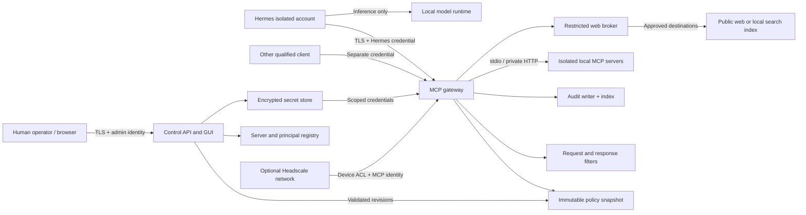

# Secure Local MCP Gateway — System Specification and Architecture

**Revision:** 1.0 — implementation baseline proposed for development  
**Date:** 2026-10-04 (America/New_York)  
**Owner:** netrisk  
**Project:** `/home/netrisk/Projects/mcp-servers`  
**Target:** Linux workstation; Ubuntu 24.04 / “Grinch” is inherited from the prior reports and must be confirmed during installation.  
**Status:** Specification only. No gateway has been installed, no firewall or agent configuration has been changed, and no runtime security tests have been executed by this documentation task.

## Navigation

- [Purpose and study decisions](#1-purpose-scope-and-binding-constraints)
- [Technology stack and licenses](#4-selected-technology-stack-and-licenses)
- [Deployment and protocol](#5-runtime-architecture-and-deployment-boundaries)
- [Server admission and allowlists](#8-server-characterization-admission-and-allowlists)
- [Filtering](#9-outgoing-query-and-incoming-response-filtering)
- [Audit and GUI](#10-audit-evidence-retention-and-operator-controls)
- [Hermes integration procedure](#12-hermes-integration-and-enforceable-cutover)
- [Headscale and Tailscale](#13-optional-zero-trust-networking-with-headscale-and-tailscale)
- [Codex and Grok Bot](#14-extension-to-codex-and-grok-bot)
- [Security controls and tests](#15-cybersecurity-best-practices-and-specification-traceability)
- [Development plan](#18-development-plan-and-exit-criteria)

## 1. Purpose, scope, and binding constraints

Build a locally operated, open-source MCP gateway that gives Hermes Agent one controlled route to approved tools. The operator must be able to characterize servers, approve precisely scoped tools, filter requests and responses, manage credentials, and investigate use through a local graphical interface. Other compatible clients can share the gateway with separate identities and policies.

The system consists of an MCP data plane, a local administration GUI and control API, an admission/testing service, a policy engine, isolated backend processes, an audit service, and a restricted web broker. Remote access through a self-hosted zero-trust overlay is an optional extension. This is a workstation application, not a Kubernetes or SaaS platform.

| ID | Binding requirement |
|---|---|
| CON-01 | All software required for the supported baseline SHALL be open source under an OSI-approved license, or public-domain software such as SQLite. Release qualification SHALL inspect bundled and transitive components, not only repository headlines. |
| CON-02 | The baseline SHALL operate without subscriptions, paid APIs, purchased applications, license servers, or cloud accounts. Existing hardware, electricity, and Internet connectivity are assumed; this is not a zero-operating-cost claim. |
| CON-03 | MCP servers, policy, audit, secrets, GUI assets, filters, and model inference for the strict local profile SHALL run locally. A remote backend SHALL require a separately approved exception recorded in the registry. |
| CON-04 | Hermes in the enforced profile SHALL have access only to the gateway for tool operations, and to a separately controlled local model endpoint for inference. All other network and host access SHALL be denied unless explicitly part of the tested profile. |
| CON-05 | Admission, authorization, required filtering, and audit failures SHALL prevent tool dispatch or result release as specified below. No outage SHALL enable a direct-server fallback. |
| CON-06 | The operator SHALL be able to manage servers, principals, allowlists, filters, credentials, audit retention, and emergency revocation through the GUI without editing policy source by hand. |
| CON-07 | Every security requirement SHALL have acceptance evidence before the deployment is described as “gateway enforced.” Configuration alone SHALL be described as “gateway configured.” |

“SHALL” indicates a mandatory, testable requirement. “MUST” is reserved for broad security conditions whose concrete controls appear as SHALL requirements. “May” identifies optional scope; selected optional features inherit their stated controls. These conventions follow the project’s parent `Resource.md`.

A model is not an MCP client by itself. Hermes, Codex CLI, and Grok Bot are agent applications that can expose model-selected actions through tools. This specification distinguishes application compatibility, model licensing, and network containment.

## 2. Disposition of the existing study

The September 21 research brief and architecture are accepted as the basis for development. Their alternatives are resolved below so implementation has a default. Historical claims about stars, maturity, licenses, and protocol versions are not treated as current evidence.

| Study recommendation | Decision in this specification |
|---|---|
| Compose reusable OSS modules; do not hand-write an MCP protocol stack | Accepted. Use the official Go MCP SDK, established policy/crypto libraries, Podman, and a small custom product layer. |
| Slim Go gateway with a TypeScript GUI; evaluate ContextForge/agentgateway | Retain the original architecture’s Go baseline. Conduct one bounded reuse spike before committing the runtime; see section 18. Neither alternate becomes an additional production proxy by default. |
| Cedar or Casbin for agent/server/tool policy | Select embedded Casbin for v1. It fits Go without a separate policy service. Cedar remains an alternative requiring a recorded decision and equivalent tests, not a second simultaneous policy engine. |
| Per-agent identities and filtered discovery | Accepted and strengthened: reauthorize calls, handles, and continuations; tool-list hiding is not access control. |
| JSONL audit directory with SQLite search index | Accepted, with mandatory security metadata, optional encrypted payloads, tamper evidence, and explicit retention/deletion semantics. |
| age-based secrets with optional OpenBao | Accepted. Use age directly for the local backend; a GUI supplies the missing management workflow. OpenBao is optional later. |
| Filter plugins and local MCP servers | Accepted and extended to mandatory outbound argument/query inspection, inbound metadata/content inspection, and backend egress containment. |
| Authentication on/off and audit off | Restricted to a separate non-production laboratory profile with synthetic data. The supported secure profile has authentication and security auditing permanently enabled. This is a deliberate strengthening required by exclusive gateway use. |
| Docker/Desktop packaging | Use rootless Podman and OCI images. Docker Desktop and proprietary secrets products are not baseline dependencies. |
| Optional ML filters | Deferred until a fully local, license-qualified detector is demonstrated. Structural checks, policy, secret rules, and containment do not depend on a model classifier. |
| Free-form audit deletion in the GUI | Replace with a controlled payload purge or segment-retention action and a retained deletion receipt; do not silently rewrite historical decision records. |

The prior architecture is preserved in `archive/Secure-MCP-Gateway-Architecture.md`. The research brief remains at `Secure-MCP-Gateway-Research-Brief.md`. This file is the current architecture. No source-code implementation is implied by any proposed command, endpoint, or schema below.

## 3. Security objectives and trust boundaries

**SEC-01:** The system MUST prevent unapproved agents and compromised tool outputs from gaining additional authority. **SEC-02:** It MUST prevent unauthorized disclosure or modification of project data and credentials. **SEC-03:** It MUST provide attributable evidence of tool decisions and administrative changes. **SEC-04:** It MUST preserve these boundaries during crashes, updates, and network changes.

Threats in scope include malicious MCP packages, altered tool descriptions, prompt injection in web content, stolen client credentials, malicious websites attacking localhost, SSRF and DNS rebinding, native agent-tool bypass, compromised backend processes, policy misconfiguration, resource exhaustion, and audit tampering by an unprivileged process.

The trusted computing base includes the host kernel, protected installation/configuration, administrative account, gateway binaries and dependencies, sandbox configuration, and audit key custody. A host root compromise or hostile administrator can defeat local enforcement; hash chains do not change that. Ordinary user-owned processes sharing credentials with an agent are not a suitable isolation boundary.



The model endpoint is an explicit non-MCP exception because inference is not tool execution. In strict mode it is local and has no web browsing, plugins, tool execution, or outbound provider fallback. A remote model could receive every prompt and tool result; an MCP gateway cannot audit or prevent that separate disclosure path without additional controls.

## 4. Selected technology stack and licenses

License observations are based on primary repositories consulted on 2026-10-04. Before building a release, P0 SHALL freeze exact source commits, image digests, dependency lockfiles, license texts, and notices in a bill of materials. “Main” URLs below are evidence locations, not permission to deploy floating branches. No whole-distribution license is inferred from this table.

| Component | Role / selection | License and evidence |
|---|---|---|
| Project gateway, broker, control API | Go; proposed project code under Apache-2.0, subject to owner’s final release choice | Project licensing decision; no release/license file created by this specification |
| Go | Runtime and build toolchain | [BSD-3-Clause](https://go.dev/LICENSE) |
| Official MCP Go SDK | MCP server/client transports and version handling | [Current license file](https://github.com/modelcontextprotocol/go-sdk/blob/main/LICENSE) describes Apache-2.0 transition with retained MIT contributions; documentation has separate terms. Capture the actual pinned release’s notices. |
| Casbin | Embedded authorization evaluator | [Apache-2.0 with third-party notices](https://github.com/casbin/casbin/blob/master/LICENSE) |
| React | Local browser GUI | [MIT](https://github.com/facebook/react/blob/main/LICENSE) |
| TypeScript | GUI source language/build tooling | [Apache-2.0](https://github.com/microsoft/TypeScript/blob/main/LICENSE.txt) |
| Vite | GUI asset build only; no production development server | [MIT](https://github.com/vitejs/vite/blob/main/LICENSE) |
| Node.js | GUI build tooling only | [MIT plus bundled third-party licenses](https://github.com/nodejs/node/blob/main/LICENSE) |
| SQLite | Configuration state and audit search index | [Public domain](https://sqlite.org/copyright.html) |
| `mattn/go-sqlite3` | Go SQLite binding; accepts a C toolchain/build dependency | [MIT](https://github.com/mattn/go-sqlite3/blob/master/LICENSE); SQLite remains public domain. Review compilation options and bundled version. |
| age / `filippo.io/age` | Secret and payload encryption; no custom cipher design | [BSD-3-Clause](https://github.com/FiloSottile/age/blob/main/LICENSE) |
| `golang.org/x/crypto` | Argon2id administrator-password hashing | [BSD-3-Clause](https://go.googlesource.com/crypto/+/refs/heads/master/LICENSE); pin module and parameters |
| Podman | Rootless OCI server packaging/isolation | [Apache-2.0](https://github.com/containers/podman/blob/main/LICENSE) |
| Linux, systemd, nftables, AppArmor | Host identities, lifecycle, mandatory access control, network enforcement | Distribution components have different licenses: Linux generally GPL-2.0-only with exceptions; systemd generally LGPL-2.1-or-later with mixed files; nftables GPL-2.0-only with some GPL-2.0-or-later files; AppArmor has GPL/LGPL components. Preserve package-specific copyright/license manifests; do not label Ubuntu with a single SPDX license. |
| Hermes Agent | Primary agent client, separately contained | [MIT](https://github.com/NousResearch/hermes-agent/blob/main/LICENSE); model/backend terms are separate |
| `llama.cpp` | Optional local inference server; proposed strict-profile default | [MIT](https://github.com/ggml-org/llama.cpp/blob/master/LICENSE); model weights require a separate license review |
| Headscale | Optional self-hosted overlay coordination | [BSD-3-Clause](https://github.com/juanfont/headscale/blob/main/LICENSE) |
| Tailscale Linux CLI/daemon | Optional overlay client paired with Headscale | [BSD-3-Clause](https://github.com/tailscale/tailscale/blob/main/LICENSE); hosted coordination and other product components must not be assumed open source |
| OpenBao | Optional later secret backend, not required for v1 | [MPL-2.0](https://github.com/openbao/openbao/blob/main/LICENSE) |
| SearXNG | Optional local metasearch service behind the web broker | [AGPL-3.0](https://github.com/searxng/searxng/blob/master/LICENSE); external search-engine use is a separate service/data-flow decision |
| Codex CLI | Optional compatible client, not required for Hermes | [Apache-2.0](https://github.com/openai/codex/blob/main/LICENSE); do not extend this license claim to the desktop app or hosted models |

All GUI fonts, scripts, styles, and documentation necessary to administer the service SHALL be served locally, with no CDN, analytics, telemetry, or third-party sign-in requirement. Optional components SHALL remain disabled until their dependencies and data flows pass admission. Software in OCI base images, CA bundles, native libraries, and browser deployment also belongs in the release inventory.

The license process SHALL preserve attribution, supply corresponding source when applicable, and fulfill copyleft obligations for modifications/distribution/network use as applicable to the actual package. This table is an engineering inventory, not a conclusion that every combination has been legally approved.

Excluded from the baseline: paid model APIs, Docker Desktop, hosted Tailscale coordination, proprietary secret managers, BUSL-only Vault releases, PolyForm Noncommercial gateways, and unreviewed “open weights” model licenses. A free subscription tier is not equivalent to open-source self-hosted software. Locally running models are feasible, but their weights, tokenizer, license, tool-calling quality, and hardware fit remain a P0 qualification item.

## 5. Runtime architecture and deployment boundaries

### 5.1 Processes and interfaces

| Process | Responsibility | Minimum authority |
|---|---|---|
| `smcp-gateway` | Authenticate, authorize, filter, route and audit MCP | Read published policies; use only assigned secrets; connect to registered backends; no arbitrary Internet access |
| `smcp-control` | Serve GUI/API; validate/publish configurations | Separate admin identity; write registry/config; no agent credentials accepted for admin operations |
| Admission worker | Scan and probe candidate servers with synthetic data | Disposable sandbox; no project data or production credentials |
| Backend workers | Execute admitted MCP functionality | One service identity/sandbox per trust class or server; narrow mounts; no admin/audit/key access |
| Web worker | Parse/extract bounded content and expose MCP web tools | No Internet access; calls only the authenticated broker; no project secrets |
| Trusted web broker | Execute individually authorized HTTP operations | Only component given narrowly scoped Internet egress; no unrestricted CONNECT tunnel |
| Audit writer | Commit decisions and payload references | Separate protected directory; no agent access; append-only application interface |
| Local inference service | Model inference | Local listener; no autonomous tools, external URLs, or remote provider failover |

Names are project design contracts. They are not commands installed by this task.

**DEP-01:** The default MCP endpoint SHALL be `https://127.0.0.1:9443/mcp`; the admin origin SHALL be `https://127.0.0.1:9444`. Certificate SANs SHALL cover the endpoint actually used. IPv6 listeners, if enabled, SHALL have equivalent rules. No listener may silently expand to `0.0.0.0` or `::`. The MCP listener SHALL reject disallowed supplied Origin values and unexpected Host values before dispatch; native clients may omit Origin but still require authentication and an approved Host. CORS SHALL not grant arbitrary websites access.

**DEP-02:** Production TLS SHALL use a locally administered CA trusted by the selected clients. No `verify=false`, insecure CLI flag, or disabled certificate checking is permitted. The private CA signing key SHALL stay outside agent and gateway-readable paths. HTTP may be used only in a recorded synthetic-data development fixture confined to loopback.

**DEP-03:** The agent SHALL run under a dedicated non-admin account or hardened container/VM. Gateway, control plane, backend, and agent identities SHALL be distinct. No agent gets sudo, host PID namespace, host networking, Docker/Podman sockets, host SSH agent, unrestricted desktop/computer-control channel, or mounts of another service’s configuration/secrets.

**DEP-04:** Upstream stdio processes SHALL be started by a dedicated supervisor with explicit executable, argument array, environment allowlist, working directory, and resource limits. The supervisor SHALL expose only validated launch profiles, not a general host-execution or container-management API. Never interpolate a shell command or execute package managers on first tool use. HTTP upstreams SHALL bind only to a gateway-reachable private network; no public host port publication.

**DEP-05:** Rootless containers SHALL use read-only root filesystems where compatible, explicit writable scratch, dropped capabilities, `no-new-privileges`, seccomp and AppArmor, no device access, and CPU/memory/PID limits. Rootless Podman alone is not proof of isolation; access to host gateways, mounted files, and sibling containers SHALL be tested.

**DEP-06:** Enforcement SHALL be installed by the host administrator outside agent control. Default-deny network rules SHALL cover IPv4, IPv6, DNS, UDP/QUIC, host-gateway aliases, local sockets, inherited proxy settings, and all children. A user-set `HTTP_PROXY` is not an enforcement mechanism. Do not depend only on host OUTPUT rules when traffic traverses bridge/FORWARD or rootless userspace networking; test the actual packet path.

For a contained agent, `127.0.0.1` refers to its own network namespace. The deployment SHALL either provide a narrow gateway relay on agent loopback or issue an endpoint/certificate for a dedicated gateway interface reachable from that namespace. Do not make the whole container use host networking to make the sample URL work.

### 5.2 Permitted network flows

| Source | Permitted destination | Explicitly denied |
|---|---|---|
| Hermes sandbox | Gateway MCP endpoint; inference-only local endpoint | Internet, DNS except required controlled resolver, backend ports, admin GUI/API, host-management services |
| Gateway | Approved backend addresses, audit/policy IPC | Arbitrary Internet, unregistered backends, local administration not needed for service |
| Filesystem MCP | Its mounted project subtree | Network, host home, keys, gateway configuration |
| Web worker | Trusted broker private API only | Internet, host services, other backend networks |
| Trusted web broker | Approved destination hosts/ports through validated resolution | Private/reserved/metadata addresses by default, arbitrary proxies, unauthorized redirects |
| Admin browser | Local admin origin | Admin access from agent-controlled browser/session |
| Overlay agent device | Gateway MCP service only | Other tailnet hosts, admin port, subnet routes, exit nodes |

In a shared kernel environment, localhost binding does not isolate services by user. OS/network policy and process credentials supply that separation. If those controls cannot be made reliable on the selected workstation, use an isolated VM and repeat the same tests.

### 5.3 Files and ownership

Source, specifications, and future development assets belong under this project. Production writable state SHALL be outside agent-writable source directories. Proposed installed paths are `/etc/smcp` for protected configuration, `/var/lib/smcp` for registry/secrets/audit, and `/run/smcp` for runtime sockets and short-lived credentials. Installation is future work, not part of this task.

Configuration publication SHALL use validated immutable revisions and an atomic pointer switch. The gateway SHALL continue using the last valid revision only if its signature, expiry, and required services are valid; otherwise it stops dispatching. Unpublished GUI edits SHALL have no runtime effect. An administrative rollback SHALL be a new recorded revision, not a rewrite of history.

## 6. MCP protocol and interoperability contract

The current published specification is **2026-07-28**. It uses per-request metadata and discovery rather than a connection-wide initialization session. The legacy **2025-11-25** profile uses `initialize` and may use session IDs. Current Streamable HTTP removes the separate GET stream and protocol sessions; SSE can still carry the response to a POST. These eras must not be mixed. See [transport overview](https://modelcontextprotocol.io/specification/2026-07-28/basic/transports), [HTTP binding](https://modelcontextprotocol.io/specification/2026-07-28/basic/transports/streamable-http), and [versioning](https://modelcontextprotocol.io/specification/2026-07-28/basic/versioning).

The [official Go SDK protocol documentation](https://github.com/modelcontextprotocol/go-sdk/blob/main/docs/protocol.md) and repository describe current-era support in v1.7.0 and later. P0 SHALL select and test an exact compatible SDK release; this document does not assert what is installed on the host. The SDK’s stateless HTTP setting and supported-version settings SHALL be configured deliberately and verified against both client eras.

| ID | Protocol requirement |
|---|---|
| MCP-01 | The production façade SHALL support 2026-07-28 and the tested 2025-11-25 compatibility profile. SDK-owned framing/version behavior SHALL be reused. Unknown or unsupported versions SHALL return protocol-appropriate errors; no permissive fallback on authentication or policy failures. |
| MCP-02 | All incoming MCP requests SHALL be authenticated and evaluated from their parsed, canonical body. For modern HTTP, required mirrored headers SHALL be checked against body values using the SDK. Mismatches SHALL be rejected before routing. |
| MCP-03 | Only implemented capabilities SHALL be advertised. v1 SHALL support tools/discovery and required lifecycle/control messages. Resources, prompts, subscriptions, task APIs, sampling, elicitation and roots SHALL be absent or denied until separately implemented and tested. |
| MCP-04 | Catalog responses SHALL be filtered by principal and published policy revision. Cached lists, cursors, handles, responses, and continuation state SHALL never cross principal or policy boundaries. HTTP and applicable protocol cache hints SHALL explicitly prevent public caching of authorization-dependent discovery, catalogs, results and errors; see section 16. |
| MCP-05 | A guessed tool name SHALL be checked identically to one returned by discovery. Registry identity SHALL be stable independent of display names and aliases. Name collisions SHALL prevent publication. |
| MCP-06 | stdio SHALL use SDK newline-delimited JSON-RPC; stdout SHALL contain protocol output only. stderr is untrusted diagnostic input and SHALL be bounded and redacted before logging. |
| MCP-07 | Legacy session state SHALL be bound to authenticated identity; current-era application handles SHALL also be owner-bound and expire. Neither a session ID nor an application handle is authentication. |
| MCP-08 | Upstream protocol translation SHALL use separate tested adapters. Legacy GET/SSE and server-initiated requests SHALL not be exposed as current-era behavior. Deprecated HTTP+SSE is excluded from v1 unless a documented backend exception passes tests. |
| MCP-09 | Cancellation SHALL propagate through the applicable SDK mechanism. Disconnects/timeouts SHALL not trigger automatic retries of potentially mutating operations. Unknown completion SHALL be reported explicitly. |
| MCP-10 | List changes, server metadata changes, errors, progress, and logs SHALL pass applicable filtering. No unfiltered content stream SHALL be forwarded while awaiting a verdict. |

Upstream support and client support are separate compatibility dimensions. Each admitted server and client SHALL record transport, protocol versions, SDK/runtime revision, unsupported features, and the test evidence for the exact pairing. Modern input-required continuations and legacy reverse requests remain denied in v1; adding either requires per-step authorization, protected user interaction, and loop limits.

## 7. Identity, authentication, and secrets

**IAM-01:** Each client instance or security role SHALL have a separate principal, such as `hermes-research`, `hermes-write`, or `codex-review`. Model names, HTTP headers claiming an agent name, IP addresses, and MCP `clientInfo` SHALL not determine authority. A validated credential maps to the principal.

**IAM-02:** v1 local clients SHALL use random high-entropy bearer credentials with at least 256 bits of generated entropy, scope, expiry, creation/last-use metadata, and immediate revocation. Store verifier hashes/HMACs for client keys, compare in constant time, and show a new key only once. Default lifetime: 30 days; rotation may overlap for at most 24 hours. Never log credential values.

**IAM-03:** Every request, including discovery and subsequent requests in a legacy session, SHALL be checked for credential revocation. Revocation SHALL block new dispatch within two seconds of published policy/key change. Recheck before releasing a result; cancellation of already-running mutations is best effort and cannot undo external effects.

**IAM-04:** The human GUI SHALL use separate admin authentication: local account, salted memory-hard password hashing such as Argon2id through a maintained library, rate limiting, short-lived server-side sessions, Secure/HttpOnly/SameSite cookies, CSRF protection, and exact Origin/Host checks. Agent bearer keys SHALL be invalid on the admin API. No default password or public bootstrap endpoint.

**IAM-05:** Initial admin creation SHALL require local administrator access to a one-use bootstrap credential in a protected file. Login failures, privilege changes, policy publications, key issuance/revocation, and bootstrap completion SHALL be audited. Admin sessions expire after 15 minutes idle and eight hours absolute by default.

**IAM-06:** Remote MCP access may use a self-hosted OAuth/OIDC service with the applicable MCP authorization profile, protected-resource metadata, audience validation, PKCE where relevant, exact redirects, and per-client consent. Static local bearer auth is a documented private deployment profile, not a claim to implement all MCP OAuth discovery flows. No hosted identity provider is required.

**SECSTORE-01:** The gateway SHALL retain backend credentials and OAuth refresh tokens separately from client keys. Client credentials SHALL never be passed through to upstream APIs. Backend credentials SHALL be scoped to the receiving backend and injected only through its allowlisted environment or a protected descriptor/file/header mechanism.

**SECSTORE-02:** The local secret store SHALL encrypt values with age. Decryption identity custody SHALL be separate from ciphertext: interactive unlock or a protected service credential provisioned by the operator. An encrypted file beside an agent-readable private key is not effective protection. The GUI SHALL support add, rotate, revoke, and reference impact preview without listing plaintext after save.

**SECSTORE-03:** An upstream process SHALL not inherit the gateway environment. Agent-model keys, audit signing keys, CA keys, and other backend secrets SHALL not be present. Dumps, traces, crash reports, and process argument lists SHALL not contain secrets. GUI “test credential” operations use a scoped worker and audit metadata only.

**SECSTORE-04:** Locked or unavailable secret storage SHALL disable affected routes. Recovery SHALL require protected backup keys and a tested restore procedure; it SHALL never enable anonymous mode.

## 8. Server characterization, admission, and allowlists

A server “allowlist” is more than an enabled checkbox. Admission says a particular artifact is acceptable to run under defined restrictions. Authorization says which principal may use each of its capabilities. Both must succeed.

### 8.1 Server record

Each record SHALL include:

- Stable server ID; display name; owner; purpose; repository/source URL; maintainer; exact version/commit; executable or image digest; SBOM and license evidence; update policy.
- Locality (`local`, `LAN`, `remote-exception`), transport, supported protocol versions, connection/launch definition, certificate identity, and dependencies.
- Manifest digest covering tool names, descriptions, annotations, input/output schemas, resource/prompt declarations, and relevant metadata. Tool annotations are untrusted claims, not security decisions.
- Operator-assigned capability and risk classification: read-only, filesystem write, network read, network write, code execution, credential handling, personal/sensitive data, destructive action.
- Exact filesystem roots and access modes; allowed network destinations/ports/methods; secret references; required filters; maximum request/response sizes; resource limits.
- Admission status, evidence, reviewer, review date, expiry, outstanding findings, exceptions, and affected agent policies. Suggested default re-review interval: 90 days, sooner on change.

### 8.2 Lifecycle and GUI workflow

`draft → quarantined → tested → approved → enabled → suspended → retired`

**ADM-01:** “Add server” SHALL first create a quarantined record. The operator sees source, license, digest, exact command/URL, requested privileges, and projected tools before anything executes. Registration SHALL not grant an agent access or run a package-manager bootstrap.

**ADM-02:** “Characterize” SHALL perform static review and a disposable sandbox probe with synthetic inputs, no production mounts/secrets and no external egress. A necessary fixture connection requires an exact, time-bounded test-network grant; an Internet exception requires separate review. It SHALL capture the manifest, measure requested file/network access, check duplicate/confusable names, validate schemas, and present descriptions as inert text. Scanners may assist; their verdict does not automatically approve a server.

**ADM-03:** “Approve” SHALL freeze the reviewed artifact and manifest, sandbox profile, filter profile, and approved tool subset. “Enable” SHALL publish those references atomically. Updates/new tools SHALL start denied and require a manifest diff/review. Auto-updates in backend containers are prohibited.

**ADM-04:** Removing a server or tool from the allowlist SHALL hide it from discovery, block new calls, invalidate relevant catalog caches, terminate/revoke continuations where possible, and stop the backend if no authorized use remains. The GUI SHALL distinguish “new calls blocked” from “in-flight work cancelled” and “side effect may already have occurred.”

**ADM-05:** The system SHALL suspend a route on detected artifact or manifest drift, mandatory scanner failure, admission expiry, or critical unresolved findings according to published policy. It SHALL not silently accept a changed description from an already approved server.

**ADM-06:** Agent credentials SHALL never permit server registration, policy changes, admission approval, filter disabling, audit deletion, or installation of software. Admin functions SHALL not be exposed as MCP tools to ordinary agents.

### 8.3 Policy decision and precedence

**POL-01:** Default deny. A call SHALL require an enabled principal, valid credential, approved exact artifact/manifest, enabled server/tool, an explicit principal–server–tool–method permit, satisfied argument constraints, available mandatory filters, and a writable audit path. Any explicit deny or failed prerequisite wins.

**POL-02:** Casbin SHALL implement a tested allow-and-no-deny effect. The surrounding policy service SHALL apply admission checks, schema/path/network predicates and mandatory obligations; do not assume the library generates those obligations. Administrative policy input SHALL be schema-validated; no arbitrary scripting/evaluation from the GUI.

**POL-03:** Overlapping permits SHALL not broaden a call accidentally. The policy compiler SHALL reject ambiguous overlapping argument grants or combine their restrictions by intersection. Required filters are combined by union, maximum limits by the most restrictive value, and a sensitive-data restriction cannot be relaxed by another matching rule.

**POL-04:** Arguments SHALL be validated against approved schemas, plus semantic controls: canonical paths with symlink/TOCTOU protections at the filesystem worker, bounded URLs/domains, exact permitted methods/actions, and output data classification. `readOnlyHint` and `destructiveHint` do not substitute for operator classification.

**POL-05:** Mutations SHALL require an explicit separate grant. High-impact actions SHALL require a one-use human approval bound to principal, tool, canonical argument digest, policy revision, and short expiry. A changed request invalidates approval. Model-generated text cannot serve as approval.

**POL-06:** Human approval requests SHALL appear in the authenticated GUI with redacted arguments and effects. v1 SHALL deny/present an out-of-band pending approval if the client cannot support a safe workflow; it SHALL not implement an unauthenticated approve URL or silently expand permissions.

The following is a **proposed project policy schema**, not existing Casbin/Hermes syntax:

```yaml
schema_version: 1
revision: 12
default: deny
principal: hermes-research
grants:
  - server: project_files
    artifact_ref: approved-artifact-17
    tool: read_file
    method: tools/call
    constraints:
      root: /workspace/research
      access: read
    filters: [schema, size, secret_output, untrusted_text]
    audit: metadata
  - server: controlled_web
    artifact_ref: approved-artifact-23
    tool: fetch
    method: tools/call
    constraints:
      schemes: [https]
      hosts: [modelcontextprotocol.io, docs.python.org]
      ports: [443]
    filters: [schema, outbound_dlp, url_policy, size, secret_output, untrusted_text]
    audit: metadata
denies:
  - capability: arbitrary_code_execution
```

The GUI SHALL provide a principal × server × tool matrix, risk indicators, argument constraints, expiry, and a simulator showing permit/deny reasons and effective obligations. “Allow server” SHALL never imply future tools or unconstrained arguments. Policy edits SHALL show affected principals and tests before publication.

## 9. Outgoing query and incoming response filtering

### 9.1 Request/response processing contract

For each call: authenticate → resolve approved catalog identity → validate shape and bounds → evaluate policy → apply outbound filters → consume any required approval → commit dispatch-intent audit → inject scoped backend credentials → execute once → inspect/buffer result → recheck policy/revocation → commit outcome audit → release approved result.

**FLT-01:** Filter context SHALL contain principal, request/event IDs, server/artifact/manifest identity, tool, direction, data classification, policy/filter revision, and whether the content is text, structured data, binary, or executable material. Plugins SHALL return `allow`, `redact`, `block`, or `quarantine` with machine-readable reason codes and redacted findings.

**FLT-02:** Required filters SHALL run before external side effects on requests and before client delivery on responses. Timeout, crash, malformed output, or missing mandatory filter SHALL block the operation/result. Optional experimental detectors may run in observation mode, visibly labeled; they cannot replace required enforcement.

**FLT-03:** The gateway SHALL inspect all enabled message surfaces, including tool descriptions/schemas, arguments, text, `structuredContent`, embedded resources, errors, diagnostic notifications, resource links, and continuations. Uninspected binary/media/archive content SHALL be blocked by default. A separately approved extraction worker may convert it into a bounded text representation for review.

**FLT-04:** Secret rules SHALL detect configured protected values and high-confidence credential patterns, private keys, access tokens, and prohibited sensitive-data patterns. Operators SHALL be able to define project names, hostnames, account identifiers, personal-data classes, and denied query terms without exposing raw matched secrets in the GUI or audit record. Pattern rules SHALL use bounded/non-catastrophic matching.

**FLT-05:** Text rules SHALL flag prompt-injection indicators, disguised instructions, suspicious control characters, bidirectional text tricks, and prohibited payload classes. Unicode handling SHALL be context-sensitive: do not erase ordinary non-English text, alter source code, or change signed content silently. Block/quarantine when a safe transformation is unclear.

**FLT-06:** Redaction SHALL preserve schema validity and indicate that data was removed. Redaction of action-defining arguments, destinations, executable code, cryptographic values, or legally/operationally significant text SHALL require a new explicit request or approval; no silent change of meaning. Reauthorize the transformed request and bind approvals to the final canonical arguments.

**FLT-07:** Filtered results SHALL retain provenance (source server, destination URL when applicable, capture time, transformation codes, and digest) and be marked untrusted data. An injection classifier cannot prove content safe; default-deny permissions and containment remain authoritative even when the classifier allows it.

**FLT-08:** v1 SHALL buffer complete bounded results before release. SDK progress messages may pass only as sanitized non-content status. No raw SSE token/chunk forwarding is permitted before screening. A future incremental mode requires a separate proof that blocked content cannot leak through earlier chunks.

### 9.2 Controlled web capability

Provide project-owned MCP tools such as `controlled_web__fetch` and `controlled_web__search` with narrow typed schemas. A generic “browse anything,” arbitrary HTTP request, shell, or URL-to-proxy tool is outside the initial allowlist.

**WEB-01:** Outgoing URLs, query strings, headers, bodies, search terms and encoded/nested URLs SHALL be inspected before network access. Tool arguments are not the only possible leak: the web worker SHALL have no direct Internet route. It may call only the trusted broker, which SHALL require a verifiable gateway-issued one-use authorization bound to principal, event ID, canonical destination/method/body digest, policy revision and expiry. The broker SHALL validate/filter and durably audit each actual operation, including redirect hops, before sending it. Reuse or alteration is denied. A destination firewall alone cannot prevent extra requests to an allowed host; the broker is part of the trusted computing base.

**WEB-02:** URL policy SHALL normalize scheme, host, IDN representation and port; reject user-info credentials, unexpected schemes, malformed addresses, ambiguous IP forms, and unauthorized methods. Host matching SHALL use exact names or explicit bounded subdomains, never naive suffix matching (`trusted.example.attacker.test`). Query redaction SHALL be shown before a changed search is executed.

**WEB-03:** Public web fetches SHALL deny loopback, private, link-local, multicast, reserved ranges, IPv4-mapped IPv6, and cloud metadata destinations. Resolve using a controlled resolver, validate all usable answers, and connect only to validated addresses with correct TLS hostname/SNI checks. Revalidate redirects and connection retries; maximum redirects: three. A hostname allowlist without connection-time address checks is insufficient.

**WEB-04:** Registry-approved local MCP services SHALL use a distinct connection policy with exact identity/address/port exceptions. Such exceptions SHALL not make private addresses available to arbitrary web-fetch arguments or OAuth metadata. Metadata discovery, authentication redirects, and any future remote MCP connections receive the same destination controls.

**WEB-05:** Fetch defaults SHALL permit HTTPS GET only, with no ambient browser cookies, login sessions, arbitrary Authorization headers, file uploads, WebSockets, or CONNECT tunneling. POST/upload/login automation requires separate explicit grants and audit. Decompression SHALL stop at an expanded-size limit; content types and archive depth SHALL be bounded.

**WEB-06:** Fetching SHALL not execute page scripts. Return extracted/sanitized text, useful source references, and bounded metadata. A full browser backend is a later, separately sandboxed capability because pages can create many unobserved network requests.

**WEB-07:** Search SHALL have two clearly labeled choices: local corpus/index search with no query disclosure outside the host; or optional self-hosted SearXNG that sends filtered queries to explicitly approved external engines. SearXNG is local software, not an offline web index, and the upstream engines may be proprietary services. The strict all-local profile SHALL keep external metasearch disabled. No paid search key is permitted in the baseline.

For the smallest complete v1, implement local document search with SQLite FTS5 and controlled URL fetching. Broad Internet search is an optional feature, not an undeclared paid/cloud prerequisite. A locally maintained web index may be added later at the cost of crawl/storage/maintenance effort. Offline operation naturally limits the available and current corpus.

### 9.3 Filter testing GUI

The GUI SHALL let an operator select a profile, submit synthetic request/response samples, see which rules matched and what will be sent/returned, and compare policy revisions. Production sensitive payloads SHALL not be copied into test fixtures automatically. Rule edits SHALL run a regression corpus containing expected blocks and benign multilingual/code examples before publication. Report false positives and false negatives; never label a passing corpus as proof against all prompt injection.

## 10. Audit, evidence, retention, and operator controls

**AUD-01:** Security metadata SHALL always be recorded: authentication failures, permitted and denied calls, policy/filter decisions, registrations, manifest drift, approvals, key changes, configuration publications, retention actions, and service failures. “Metadata” excludes query bodies, secrets, and arbitrary free-text user content.

**AUD-02:** Every operation SHALL have an event/trace ID linking intent, dispatch, completion, filtering and client delivery. Record UTC timestamp, monotonic duration, principal/key ID (not value), server/artifact/tool IDs, method, policy/filter revision, reason codes, request/result sizes, sanitized destination category, and outcome. Client-supplied request IDs are correlation data, not trusted identities.

**AUD-03:** Before any upstream dispatch, the audit writer SHALL durably commit intent/decision. Before result release, it SHALL commit completion/delivery decision. If storage fails, fail closed and alert. After an upstream mutation with lost completion evidence, record an indeterminate outcome on recovery and do not repeat it automatically. Use a bounded durable spool, not silent log dropping.

**AUD-04:** Full-payload capture SHALL be opt-in per principal/server/data class and time window, with a visible GUI indicator and default maximum window of 24 hours. Secrets SHALL be redacted before persistence in all modes. Payload capture cannot override a “do not retain” classification. A blocked malicious payload is retained only in an explicitly enabled encrypted quarantine store.

**AUD-05:** Store append-only, rotated JSONL event segments with an SQLite search index. Encrypt retained payload blobs with age and separate access controls. Store digests of redacted representations; use keyed commitments when correlation is needed for low-entropy sensitive values. Ordinary hashes of short secret-like values can reveal them through guessing and SHALL not be used as a privacy measure.

**AUD-06:** Chain event hashes and sign closed-segment manifests/checkpoints using a maintained cryptographic library. Preserve checkpoint copies in operator-controlled offline/separate storage. This is tamper evidence, not root-proof immutability. The index SHALL be reconstructible from valid event segments; recovery SHALL detect truncation, broken chains, and gaps.

**AUD-07:** Default retention SHALL be 90 days for security metadata and seven days for opted-in redacted payloads. Provide configurable disk quota (initial target 10 GiB), capacity warning at 80%, and controlled dispatch stop before safe audit capacity is exhausted. Payload deletion SHALL not silently delete decision evidence. Metadata rotation/purge SHALL leave a signed segment inventory/receipt according to retention policy.

**AUD-08:** GUI purge/export SHALL require an authorized admin, scope preview, a reason, and a separate audit event. Exports SHALL redact secrets, include policy/version context and integrity manifests, and protect CSV consumers from formula injection. Purge cannot promise secure erasure of SSD blocks, snapshots, or backups; expose backup retention separately. Payload key destruction may support crypto-erasure if all key copies are accounted for.

**AUD-09:** Backups SHALL encrypt policy, registry, secrets and retained audit data; keys SHALL be backed up separately. A restore exercise SHALL verify permissions, decryptability, policy identity, checkpoint consistency, and revoked-key handling before enabling dispatch.

Illustrative metadata schema; field values are synthetic and not an actual event:

```json
{
  "schema_version": 1,
  "event_id": "generated-uuid",
  "trace_id": "generated-trace-id",
  "timestamp": "2026-10-04T21:00:00Z",
  "phase": "decision",
  "principal": "hermes-research",
  "credential_id": "key-17",
  "server_id": "controlled_web",
  "artifact_ref": "approved-artifact-23",
  "tool": "fetch",
  "method": "tools/call",
  "policy_revision": 12,
  "filter_revision": 4,
  "decision": "deny",
  "codes": ["EGRESS_PRIVATE_ADDRESS"],
  "request_bytes": 184,
  "payload_ref": null,
  "previous_event_hash": "sha256-reference"
}
```

The audit GUI SHALL offer time/agent/server/tool/outcome/reason filters, linked execution timelines, counts and trends, denied-call review, filter test follow-up, and redacted detail views. Raw tool output SHALL be rendered as inert text; never execute HTML/Markdown scripts or automatically load remote image/URL previews from an audit record.

## 11. Administration GUI and control API specification

The GUI is a local browser application. No paid desktop shell is required. It SHALL provide keyboard access, clear labels, accessible contrast, and status explanations that distinguish configured controls from verified enforcement.

| Screen | Required capabilities |
|---|---|
| Overview | Enforcement mode, active policy revision, audit/secret health, blocked routes, backend health, network containment test date, emergency stop |
| Servers | Characterization card, license/source/artifact identity, privileges, manifest diff, quarantine test, approve/enable/suspend/retire |
| Principals | Create/disable role, issue/rotate/revoke keys, last use, assigned tools, effective access preview |
| Allowlist | Matrix and constraint editor, deny precedence, new tools default denied, policy simulator, diff and publish/rollback |
| Filters | Incoming/outgoing profiles, rule ordering, required/observation status, synthetic tests, redaction preview, failures |
| Approvals | Pending high-impact operations, exact redacted argument digest/effect/expiry, approve once or deny |
| Audit | Search, timeline, details, integrity status, export, retention, scoped payload purge and receipts |
| Secrets | Write-only create/rotate/revoke, backend reference mapping, lock/unlock state and recovery checks |
| Network / zero trust | Allowed flows, overlay enrollment/policy status, drift, host enforcement health, connectivity probes |
| System | Local listeners/CA expiry, version/license inventory, backup/restore status, deployment qualification evidence |

**GUI-01:** An emergency stop SHALL immediately publish deny-all for new tool execution and request cancellation of in-flight work. Recovery SHALL require an authenticated admin and produce a new audit event. The UI SHALL explain that completed external side effects cannot be rolled back by cancellation.

**GUI-02:** No agent-controlled field SHALL execute code in the operator browser. Apply CSP, output escaping, content-type checks, CSRF protection, bounded uploads, exact CORS/Origin rules, and no remote embedding. Admin APIs SHALL validate the same rules even when called without the GUI.

**GUI-03:** Administrative writes SHALL use revision preconditions (`If-Match` or equivalent) to prevent lost updates. Publication SHALL validate complete referential integrity: principal, artifact, tool, filter, secret and sandbox references. The previous valid configuration remains recoverable.

Proposed API (project-owned, **not existing product endpoints**):

| Endpoint | Behavior |
|---|---|
| `GET /api/v1/status` | Redacted service/enforcement health; authenticated detailed view |
| `GET/POST/PATCH /api/v1/servers` | Registry drafts and constrained state transitions |
| `POST /api/v1/servers/{id}/characterize` | Quarantine job; never grants production permission |
| `POST /api/v1/servers/{id}/approve` | Bind reviewed artifact/manifest and privileges |
| `POST /api/v1/servers/{id}/suspend` | Revoke effective use and request cancellation |
| `GET/POST/PATCH /api/v1/principals` | Principal lifecycle |
| `POST /api/v1/principals/{id}/credentials` | One-time credential issuance; no plaintext read endpoint |
| `POST /api/v1/credentials/{id}/revoke` | Revoke and invalidate authorizations |
| `POST /api/v1/policies/simulate` | Evaluate synthetic request without dispatch |
| `POST /api/v1/policies/publish` | Validate/atomically publish revision |
| `POST /api/v1/filters/test` | Synthetic bounded fixture evaluation |
| `POST /api/v1/approvals/{id}/decision` | Bind one-use human decision to exact operation |
| `GET /api/v1/audit` | Bounded cursor query; all payload detail authorization enforced |
| `POST /api/v1/audit/exports` | Redacted evidence export job |
| `POST /api/v1/audit/purges` | Scoped retention/payload deletion with receipt |
| `POST/PATCH /api/v1/secrets` | Secret write/rotation; never secret listing values |
| `POST /api/v1/emergency-stop` | Deny execution immediately |

Audit and policy are not disabled through production API endpoints. Worker/control IPC SHALL use protected Unix sockets or authenticated private channels. The browser SHALL never receive the Podman socket, Headscale admin key, audit signing key, or secret-store decryption identity.

## 12. Hermes integration and enforceable cutover

### 12.1 Observed baseline and limits of inspection

Read-only review found a Hermes source checkout at `/home/netrisk/.hermes/hermes-agent`, commit `6f7a7991bb069db07ae74a479823ce8310f8c7e0` dated 2026-09-27. That checkout pins Python MCP SDK 2.0.0 and mentions protocol 2026-07-28. This identifies inspected source, not the interpreter/package used by every running Hermes instance. Existing configuration, `.env`, credentials and session logs were not read or changed.

The [pinned tools configuration source](https://github.com/NousResearch/hermes-agent/blob/6f7a7991bb069db07ae74a479823ce8310f8c7e0/hermes_cli/tools_config.py) shows that unspecified platform selections can include all enabled MCP servers and that plugins/native capabilities can add tools. The [MCP reference](https://hermes-agent.nousresearch.com/docs/reference/mcp-config-reference) documents HTTP/stdio, credential interpolation, filtering, TLS, and trust settings. This is why the following procedure includes a runtime manifest check and OS containment.

### 12.2 Step-by-step installation and migration procedure

These are future operator/developer actions. Run them only after a functioning gateway passes P0–P3. Do not paste placeholder tool names/hostnames without substituting deployment values.

1. **Inventory the active Hermes installation.** Run `hermes --version`; record executable/interpreter paths, actual package/commit, enabled interfaces, profiles, plugins and auxiliary providers. Store redacted evidence. Identify old Hermes terminal sessions, messaging services, cron jobs, editor/ACP integrations, and auto-start entries that could retain direct access.
2. **Create the isolation boundary first.** Provision a dedicated Hermes service account/container with no sudo or host management sockets. Configure the flows in section 5. Give the agent only its approved working directory and narrow session-state storage. Install fixed Hermes code read-only. Verify that the selected gateway and local inference endpoints are reachable from inside the namespace before applying the strict profile.
3. **Prepare local inference.** Select an approved local runtime/model, explicitly configure the provider, and disable cloud fallbacks and remote auxiliary models. Test title generation, summarization/compression, routing and other auxiliary paths as well as chat. Do not copy a profile containing remote API keys or managed connectors into the strict runtime.
4. **Admit initial servers in the GUI.** Begin with a read-only project-files server and a controlled web-fetch/local-search server. Review artifacts, manifest, licenses, mounts and egress; approve only necessary tools. Create principal `hermes-research` with those exact grants and metadata audit. Issue a separate client token.
5. **Create a clean Hermes profile under the isolated account.** Use `hermes profile create gateway-only --no-alias`. Resolve the profile’s actual configuration location from the installed version. Preserve a protected backup of any migrated settings. A profile is configuration separation, not a security sandbox.
6. **Write the dedicated profile.** Configure exactly one MCP entry, `secure_gateway`, with the GUI-issued endpoint, valid CA path, and token environment reference. Use the example below. Remove direct server definitions; do not leave them merely disabled in writable agent-controlled configuration. Do not enable portable plugins, install hooks, or editor-injected servers in this profile.
7. **Provision the client token.** Supply it through a protected service environment/credential mechanism readable only by the contained Hermes identity and required parent service. If using the active profile’s `.env`, make it mode 0600, exclude it from backups to untrusted locations/version control, and prevent model-visible file tools from reading it. This is a client credential, never a gateway admin or upstream secret.
8. **Protect accepted configuration.** The operator owns the profile configuration and startup wrapper; the agent cannot rewrite them. The launcher SHALL construct an allowlisted environment, rejecting inherited `HERMES_GUEST_ONBOARDING`, `HERMES_TUI`, provider/model overrides, unapproved proxy settings, `PYTHONPATH` and other import-path/startup overrides. Explicitly set `nous.guest: false` to prevent guest cloud identity bootstrap. See the inspected [guest-auth source](https://github.com/NousResearch/hermes-agent/blob/6f7a7991bb069db07ae74a479823ce8310f8c7e0/hermes_cli/anon_auth.py) and [bootstrap source](https://github.com/NousResearch/hermes-agent/blob/6f7a7991bb069db07ae74a479823ce8310f8c7e0/hermes_cli/free_tier_bootstrap.py). Permit only necessary session/state directories to be writable. Monitor changes to startup commands, plugin paths and profile files. Avoid a wrapper that sources arbitrary agent-writable shell files.
9. **Select only the gateway toolset.** Set the CLI platform to `secure_gateway`, use global native-toolset exclusions as defense in depth, and launch with `--cli` and `--toolsets secure_gateway`. Remove all non-gateway runtime tools or explicitly record any harmless UI-only exception. For literal exclusive tool use, the default has no such exception.
10. **Stop every old execution surface.** Stop old CLI processes and messaging services before cutover, disable old auto-start definitions, and start a fresh isolated process. The Hermes messaging “gateway” is a different service from this Secure MCP Gateway. `/reload-mcp` can refresh MCP tools, but is not a security cutover that proves all old capabilities are gone.
11. **Inspect the actual resolved tool set.** Run the commands below and inspect `/tools` in a fresh session. A guard SHALL compare resolved runtime tool names and configured MCP endpoints to the approved manifest at startup, after every registry/configuration refresh, and before dispatch; it SHALL refuse service on an unexpected tool or endpoint. Alternatively the qualified runtime may prohibit refresh/mutation entirely until the operator performs a new validated startup. This guard is a development requirement, not a built-in capability claimed here.
12. **Run the bypass and failure tests.** Prove both successful permitted use and rejection of direct-network, backend, admin, filesystem, plugin/ACP, credential-revocation, and gateway-outage attempts. Record gateway audit IDs and OS packet/denial evidence without real secret data. Only then label the profile “gateway enforced.”

### 12.3 Hermes profile example

This is a merge fragment for the **new isolated profile**, based on the reviewed Hermes version. Gateway public tool names below are proposed project names; replace them with the exact approved names actually returned by the gateway. Do not use Hermes’s prefixed display names in `tools.include`.

```yaml
mcp_servers:
  secure_gateway:
    url: "https://127.0.0.1:9443/mcp"
    headers:
      Authorization: "Bearer ${SECURE_MCP_HERMES_TOKEN}"
    ssl_verify: "/etc/smcp/pki/gateway-ca.pem"
    enabled: true
    timeout: 60
    connect_timeout: 15
    supports_parallel_tool_calls: false
    trust: untrusted
    sampling:
      enabled: false
    elicitation:
      enabled: false
    tools:
      include:
        - project_files__read_file
        - controlled_web__fetch
        - local_docs__search
      resources: false
      prompts: false

platform_toolsets:
  cli: [secure_gateway]

agent:
  disabled_toolsets:
    - web
    - search
    - x_search
    - terminal
    - file
    - browser
    - computer_use
    - code_execution
    - delegation
    - cronjob
    - connections
    - skills
    - vision
    - video
    - image_gen
    - video_gen
    - tts
    - memory
    - session_search
    - context_engine
    - kanban
    - desktop_ui
    - project

nous:
  guest: false

model:
  provider: custom
  default: "<approved-local-tool-capable-model>"
  base_url: "http://local-inference:8000/v1"
```

The loopback gateway URL works only where the gateway or a constrained relay is in that namespace. Use the isolated interface hostname and matching certificate from deployment if not. The illustrative inference URL likewise requires an explicitly provisioned local service; protect it with namespace restrictions and authentication where supported.

Hermes uses Streamable HTTP by default for URL entries; do not force legacy SSE. Leave protocol negotiation at the tested default unless the compatibility tests require an explicit supported mode. Missing token variables must fail connection, never downgrade authentication. `tools.include` takes precedence over `exclude`; use one clear positive list. `trust: untrusted` adds client-side caution but does not provide containment. Sampling and elicitation are explicitly disabled because they can create additional model/user-interaction paths.

Hermes exposes names like `mcp__secure_gateway__<sanitized-tool-name>`; admission SHALL verify the actual output and reject collisions. The global disable list is version-specific and incomplete as a future boundary. The exact runtime allowlist and protected OS deployment remain mandatory.

### 12.4 Operator verification commands

```bash
hermes --version
hermes profile create gateway-only --no-alias
hermes -p gateway-only mcp list
hermes -p gateway-only mcp test secure_gateway
hermes -p gateway-only tools --summary
hermes -p gateway-only --cli chat --toolsets secure_gateway
```

Create the profile once; do not repeat its creation on every startup. `mcp test` contacts the configured server. Use the approved service wrapper for production so the correct account, namespace, credentials, profile and environment are always applied. These commands are supported in the reviewed [CLI reference](https://hermes-agent.nousresearch.com/docs/reference/cli-commands); test them against the frozen runtime before automating.

### 12.5 Native tools, plugins, ACP, and messaging surfaces

**HERMES-01:** Strict v1 SHALL qualify the CLI only. Messaging bots, schedulers, editor integrations and ACP SHALL be disabled until separately tested under the same isolation and exact runtime allowlist.

**HERMES-02:** Native terminal/file/browser/computer-use/web/delegation capabilities and plugin-provided equivalents SHALL not be available. Moving an unrestricted shell into MCP does not make it safe; such a server still needs independently enforced filesystem/network restrictions and an explicit action model.

**HERMES-03:** ACP is specifically excluded because the documented host flow can add `session/new` MCP server definitions outside the configured server list. Future support SHALL reject client-supplied endpoints/commands except the approved gateway and re-run containment tests. See [Hermes ACP](https://hermes-agent.nousresearch.com/docs/user-guide/features/acp).

**HERMES-04:** Secret environment handling in Hermes SHALL not be relied on to isolate backend credentials. The gateway supervisor supplies its own explicit environment. The inspected [MCP environment source](https://github.com/NousResearch/hermes-agent/blob/6f7a7991bb069db07ae74a479823ce8310f8c7e0/tools/mcp_tool_config.py) passes some configured external-secret names as well as explicit values to children.

**HERMES-05:** Any newly enabled Hermes interface, plugin or version SHALL require a fresh resolved-tool manifest and regression run. An operator request to add a tool changes the qualification baseline; it is not permission to bypass the gateway controls.

Additional references: [global toolset controls](https://hermes-agent.nousresearch.com/docs/user-guide/configuration#global-toolset-disable), [MCP feature behavior](https://hermes-agent.nousresearch.com/docs/user-guide/features/mcp), [local providers](https://hermes-agent.nousresearch.com/docs/integrations/providers), [model and auxiliary configuration](https://hermes-agent.nousresearch.com/docs/user-guide/configuring-models).

## 13. Optional zero-trust networking with Headscale and Tailscale

The baseline works on one host without an overlay. For another owned machine, select **self-hosted Headscale plus the open-source Linux Tailscale daemon/CLI**. An encrypted overlay supplies authenticated device reachability; gateway authentication and per-tool authorization are still required. Tailscale’s hosted coordination server is proprietary, so its free tier does not satisfy the strict baseline. [Source boundaries](https://tailscale.com/opensource), [Headscale scope](https://headscale.net/stable/).

**ZT-01:** The overlay SHALL have an explicit deny-all policy before any agent device is enrolled. Headscale permits broad connectivity when no policy is loaded or ACL/grants sections are omitted. For the documented Headscale 0.29.1 policy format, the initial policy is:

```json
{
  "grants": []
}
```

Then add and validate exact client-device-to-gateway MCP permissions and separate administrator-device-to-GUI permissions. Do not authorize agent devices to reach the admin port, backend network, arbitrary LAN services, subnet routes, exit nodes or SSH. Test the exact pinned release’s policy syntax; current Headscale lacks some managed Tailscale features, including device-posture policy. [Headscale policy](https://headscale.net/0.29.1/ref/policy/).

**ZT-02:** Node enrollment SHALL use narrowly scoped, short-lived enrollment credentials, manual/operator approval, named ownership, key expiry, and revocation. Headscale admin credentials SHALL remain in the control service, never browser JavaScript or agent environments. Revoking an agent device SHALL also revoke/rotate its gateway credential as appropriate.

**ZT-03:** The MCP listener SHALL bind only to the intended overlay/private interface with valid TLS and gateway credentials. Host firewall rules SHALL also protect LAN and loopback paths; an overlay ACL cannot stop a bypass through a different interface. Disabling the overlay SHALL not cause a public bind.

**ZT-04:** A strict self-hosted deployment SHALL use an owned relay when a relay is needed and remove default external DERP URLs. In Headscale’s documented configuration, enabling its embedded relay does not alone remove other relays; set `derp.urls: []` for the owned-relay profile and retain `verify_clients: true` for embedded DERP. If standalone `derper` is selected, require `-verify-client-url-fail-open=false` with a configured verifier; relay access SHALL fail closed when verification fails. Validate direct and relay paths, DNS, certificates, outages and recovery before relying on remote access. An owned public relay may need existing reachable hardware/IP connectivity; no rented service is assumed. [DERP configuration](https://headscale.net/stable/ref/derp/).

**ZT-05:** The gateway GUI SHALL expose overlay enabled/disabled state, enrolled-device inventory, policy revision, last validation, expiry/revocation state and narrow enrollment/revocation actions through an optional adapter. Headscale has no built-in GUI; community GUIs require separate qualification. The gateway GUI SHALL not offer a free-form root shell or unrestricted network-policy editor to agent identities. [Headscale web interfaces](https://headscale.net/stable/ref/integration/web-ui/).

Remote-access rollout: qualify the local gateway first → install pinned Headscale/Tailscale on owned hosts → apply deny-all and register gateway/admin roles → add one client-to-MCP rule → verify unauthorized reachability fails → issue a distinct MCP principal/key → test revoke/outage → admit the remote client. No Internet-exposed MCP/admin endpoint is required.

## 14. Extension to Codex and Grok Bot

### 14.1 Compatibility versus requirement compliance

| Client | MCP gateway feasibility | Compliance with current constraints |
|---|---|---|
| Hermes CLI in the specified sandbox | High; verified configuration/source support, end-to-end qualification still required | Can meet local OSS/no-paid baseline with approved local inference and tested containment |
| Codex CLI | High; supports HTTP MCP and environment-sourced bearer keys | Open-source CLI can use local inference; qualifies only after native tools/plugins and OS boundaries pass tests |
| Codex desktop/cloud | MCP integration may be technically possible | Do not assume the complete product is an OSS/local/no-paid deployment; excluded from baseline |
| Grok Bot desktop agent | Conditional; official docs describe connectors/private-network patterns, exact gateway integration untested | Current paid access and cloud execution conflict with the stated baseline; excluded |
| Other MCP-capable open-source agents | High when transport/auth/catalog behavior matches | Admit per-client version with separate principal, manifest and bypass tests |

### 14.2 Codex CLI integration procedure

Read-only inspection found installed Codex CLI **0.111.0**; its package declares Apache-2.0 and its help exposes HTTP MCP bearer-token configuration and local-provider mode. Online documentation may describe a newer version. Freeze/test the actual runtime before copying newer options. The [official MCP documentation](https://learn.chatgpt.com/docs/extend/mcp?surface=cli) describes the supported server configuration, and the [open-source scope](https://learn.chatgpt.com/docs/open-source) distinguishes CLI/SDK/app-server from other products.

1. Provision a separate contained Codex identity and protected configuration home. Do not inherit personal MCP plugins, provider credentials, startup hooks, or trusted-project overrides.
2. Create principal `codex-review`, initially read-only, with its own token and approved tool list. Share backend servers only where policies permit; never reuse the Hermes token.
3. Configure only this gateway as an enabled MCP server. Inspect the effective configuration, including project-local configuration, managed configuration and plugin-provided servers. Those paths must not be writable by the agent in a way that changes the approved configuration.
4. Use the following example, substituting actual endpoint/tool names. `required = true` makes gateway startup failure visible rather than silently proceeding without it.

```toml
web_search = "disabled"

[mcp_servers.secure_gateway]
url = "https://127.0.0.1:9443/mcp"
bearer_token_env_var = "SECURE_MCP_CODEX_TOKEN"
enabled = true
required = true
startup_timeout_sec = 20
tool_timeout_sec = 60
enabled_tools = ["project_files__read_file", "controlled_web__fetch", "local_docs__search"]
```

5. Establish local CA trust using the mechanism supported by the pinned Codex HTTP client. The TOML above does not add a CA path. Never bypass verification; test this before admission. Apply the namespace/loopback qualification from section 5.
6. Disable supported native shell/execution and web features in the pinned version and remove unapproved plugins. The [configuration reference](https://learn.chatgpt.com/docs/config-file/config-reference) lists controls such as `features.shell_tool` and `features.unified_exec`; their availability and coverage must be verified. A native file edit or browser path may still exist after disabling shell. If any non-gateway tool remains, either disable it through a tested mechanism or do not claim literal gateway-only use.
7. Select local inference. An optional qualification route is the OSS CLI with local Ollama and separately approved weights. `codex --oss --local-provider ollama --model <installed-approved-model>` is a template, not a command to paste with angle brackets. Ollama is [MIT](https://github.com/ollama/ollama/blob/main/LICENSE); review each model license and hardware fit independently. See [local-provider configuration](https://learn.chatgpt.com/docs/config-file/config-advanced).
8. Repeat the Hermes acceptance tests for the Codex process tree, including local filesystem authority, direct HTTP, alternate MCP config/plugin injection, all inference/auxiliary paths, and gateway outage. OS containment is mandatory even if UI approvals are enabled.

The verified CLI can add a server using the following syntax, but an operator must ensure this modifies the dedicated configuration only:

```bash
codex mcp add secure_gateway --url https://127.0.0.1:9443/mcp --bearer-token-env-var SECURE_MCP_CODEX_TOKEN
```

Use either controlled config provisioning or the add command, then review the result; do not accumulate duplicate entries. It does not remove other servers, set the tool allowlist, add `required`, or establish containment automatically. Codex’s ability to expose its own `mcp-server` is a different feature and is not needed for it to consume this gateway.

### 14.3 Grok Bot desktop agent feasibility

The user clarified that “GrockBot” means **Grok Bot, xAI’s desktop agent**. Its official [overview](https://docs.x.ai/grok-bot/overview) describes a desktop/mobile interface with a persistent cloud computer, and [getting started](https://docs.x.ai/grok-bot/get-started) requires an eligible paid plan and cloud data storage. Desktop availability therefore does not establish local execution or open-source availability.

**Decision:** Do not deploy or purchase Grok Bot as part of this system. Its integration is an assessed future exception, not part of the accepted no-paid/local baseline. No fully open-source self-hosted Grok Bot distribution was established in the reviewed sources.

Official documentation describes [administrative connector controls](https://docs.x.ai/grok-bot/teams-and-enterprises) and [private-network access](https://docs.x.ai/grok-bot/private-networks). These indicate technical integration paths, but some controls require Enterprise and a tested Headscale-specific configuration was not established. A cloud-side `localhost` points at that cloud computer, not this workstation.

If requirements later change, a feasibility trial would have to establish the exact custom MCP connector/transport/authentication UI, private reachability, CA trust, separate gateway credentials, narrow tool grants, and independent containment of browser/shell/computer-use paths. Gateway-only MCP configuration alone cannot control those other capabilities. Bots can share account-level files, credentials and connectors; without a verified Bot-specific identity, use an account/integration principal rather than assuming each named Bot is isolated. [Shared computer model](https://docs.x.ai/grok-bot/computer-and-apps).

Do not reuse Grok Build CLI commands as Grok Bot desktop procedures. [Grok Build MCP configuration](https://docs.x.ai/build/features/mcp-servers) belongs to a separate product. No speculative Grok Bot config file or “exclusive gateway” switch is supplied here.

## 15. Cybersecurity best practices and specification traceability

This is a project control mapping, not a certification claim. The [MCP security guidance](https://modelcontextprotocol.io/docs/2026-07-28/tutorials/security/security_best_practices) informs identity, proxy and local-server boundaries; the [OWASP MCP Top 10](https://owasp.org/projects/mcp-top-10) supplies a risk checklist. [OWASP logging guidance](https://cheatsheetseries.owasp.org/cheatsheets/Logging_Cheat_Sheet.html), [prompt-injection guidance](https://cheatsheetseries.owasp.org/cheatsheets/LLM_Prompt_Injection_Prevention_Cheat_Sheet.html), and [SSRF prevention guidance](https://cheatsheetseries.owasp.org/cheatsheets/Server_Side_Request_Forgery_Prevention_Cheat_Sheet.html) provide supporting references. The concrete controls below are tailored engineering requirements.

| Best practice / risk | Required controls in this specification | Acceptance evidence |
|---|---|---|
| Least privilege and default deny | POL-01–06; per-principal exact tool/argument grants; separate mutation approvals | T03–T05, T11 |
| Authenticate at every trust boundary | IAM-01–06; DEP-01–03; device identity supplements MCP identity | T02, T06, T17 |
| Avoid token misuse and confused-deputy behavior | SECSTORE-01–04; audience/scope separation; no passthrough | T02, T13 |
| Prevent tool poisoning and supply-chain substitution | ADM-01–06; digests, reviewed manifest and no automatic updates | T04, T15 |
| Treat remote output as untrusted | FLT-01–08; GUI-02; no authority derived from text | T08–T10 |
| Prevent SSRF/DNS rebinding and unauthorized egress | WEB-01–06; Origin/Host checks; DEP-06 | T02, T07, T12 |
| Prevent command injection and path escape | Argument-array process launch; POL-04; sandboxed filesystem worker | T05, T12 |
| Isolate untrusted local code | DEP-03–06; quarantine probe without production data/secrets | T12, T15 |
| Prevent shadow MCP and native-tool bypass | HERMES-01–05; protected configs, exact runtime allowlist, OS rules | T01, T12, T18 |
| Make policy enforcement complete | MCP-01–10; publication validation; private caches; rechecks | T03, T04, T06, T14 |
| Record accountable, privacy-conscious evidence | AUD-01–09; no unlogged dispatch; redacted exports | T09, T10, T16 |
| Fail safely and resist exhaustion | CON-05; fixed budgets; bounded queues; no mutation retry | T10, T14, T19 |
| Protect the administration plane | Separate account/origin; GUI-01–03; CSRF/CSP/XSS controls | T02, T11, T17 |
| Patch with reproducible provenance | P0 bill of materials, signed/digest-pinned releases, staged upgrade/rollback | T15, T16 |
| Avoid over-sharing to model providers | Local inference exception explicitly constrained; no cloud fallback | T18 |
| Maintain practical human control | One-use approval, emergency stop, visible exceptions and revocation | T06, T11 |

**SUPPLY-01:** Every release SHALL include source/dependency/image manifests, license notices, a machine-readable SBOM, integrity digests, and the acceptance report. Vulnerability scanning SHALL be available locally with no paid scanner. Select and license-qualify the scanner in P0; missing coverage is a release blocker, not an implicit “clean” result.

**SUPPLY-02:** Critical reachable vulnerabilities SHALL suspend affected routes until patched or an explicitly recorded, time-limited compensating control is approved by the operator. Updates SHALL be staged with synthetic data and manifest diffs; rollback SHALL preserve security-policy changes and revocations. A rollback must not resurrect a revoked key or retired server.

## 16. Resource budgets, failure behavior, and acceptance tests

### 16.1 Initial engineering targets

These are proposed acceptance thresholds, not measured performance claims. P0 records test hardware and may revise them through a documented decision before implementation.

| Limit | Initial value / behavior |
|---|---|
| HTTP pre-routing limits | 16 KiB total headers, five-second header deadline, fifteen-second body deadline, 32 concurrent unauthenticated requests and 10 requests/second per source with burst 20; global connection cap 128 |
| JSON request size | 1 MiB enforced while reading before parsing, smaller per-tool limits supported |
| Expanded response size | 8 MiB, including decoded embedded content; excess blocked before release |
| JSON nesting / parsing work | Max depth 32; bound strings, array sizes, schema work and total processing |
| Concurrency | Four active calls per principal, sixteen total; bounded queue of 32; excess rejected |
| Rate limit | Initial 60 tool calls/minute per principal with burst 10; lower per-tool limits permitted |
| Default execution timeout | 45 seconds upstream; client timeout 60 seconds; longer jobs need explicit policy |
| Filter timeout | Two seconds per request/response profile; mandatory timeout blocks |
| Revocation propagation | Block new dispatch within two seconds of publication |
| Admission default | No network or secrets; two-minute probe timeout; bounded filesystem scratch |
| Backend resources | Start with 512 MiB RAM, one CPU, 128 PIDs per simple worker; explicitly raise for qualified services |
| Gateway overhead | Target p95 ≤100 ms for a 64 KiB local result at eight concurrent requests, excluding upstream/inference; mandatory durable audit included |
| GUI query target | p95 ≤2 seconds over 100,000 metadata events on recorded reference hardware |
| Core footprint | Target ≤1 GiB idle gateway/control/index memory, excluding browser, backends, and models |

Listener bounds SHALL apply before authentication, JSON parsing, decompression or routing, with bounded memory and aggregate connection handling. IP-based pre-auth throttling supplements credentials and is not an identity mechanism. T02/T19 SHALL exercise slow headers, excessive unauthenticated streams and deeply nested bodies. Timeouts SHALL leave time for filtering/audit before the client deadline; reject admission of a profile whose combined budget exceeds it. Circuit breakers SHALL stop repeated failed upstream calls without opening alternate routes. Cache entries SHALL be principal-scoped; authorization-dependent HTTP responses SHALL use `Cache-Control: no-store`, and protocol `cacheScope` SHALL use the applicable non-public setting; never inherit a public default. Cache keys SHALL include principal, relevant credential scope, policy revision, artifact/manifest and filter revision. Shared caching is permitted only for deliberately classified public content with tests.

### 16.2 Mandatory acceptance matrix

Tests SHALL use synthetic secrets and data, capture pass/fail evidence, and run for each released client/protocol/profile combination. Network tests must originate from the real contained execution domain, not merely from an unrelated test container. No production mutation target is needed.

| Test | Stimulus | Required result / evidence |
|---|---|---|
| T01 — Client inventory | Start fresh Hermes with approved profile; introduce an extra plugin/native tool/server | Approved list initially exact; changed tool manifest prevents qualified startup; endpoint/config report retained |
| T02 — Authentication and local HTTP | Missing/expired/wrong key; forged client name; invalid Origin/Host; invalid TLS; modern header/body mismatch | Rejected before tool dispatch; correct status/error for protocol; sanitized security event; no fallback |
| T03 — Discovery and direct denial | Two principals have different grants; guess a hidden tool or reuse catalog cursor | Each sees only its tools; guessed calls/cross-principal state denied; cache isolation demonstrated |
| T04 — Change and revocation | Change schema/description/image; remove tool grant while request queued | Drift quarantines route; queued call rechecked; no newly discovered tool becomes automatically allowed |
| T05 — Argument escape | Path traversal/symlink race; forbidden URL/method; altered approved arguments | Deny or safe constrained resolution; no out-of-root file read/write; changed approval cannot execute |
| T06 — Identity lifecycle | Revoke key mid-session; reuse state handle from another principal; emergency stop | No new dispatch after target interval; withheld unauthorized result; owner mismatch rejected; in-flight outcome recorded |
| T07 — Web egress | DNS rebind, redirect to metadata/localhost, IPv6 private address, lookalike suffix, encoded destination | Block before connection; connection trace verifies no forbidden packet reaches destination |
| T08 — Outbound DLP | Query/body/header includes synthetic secret or prohibited data | No external query sent; redacted violation only; safe changed query needs appropriate fresh authorization |
| T09 — Inbound content | Injection text, invisible controls, secret, malicious HTML, binary and oversized compressed content | Required rules produce expected allow/redact/block; no raw chunks or active HTML leak; benign Unicode/code corpus preserved |
| T10 — Filter/audit failures | Kill mandatory filter; fill disk; make audit store read-only; disconnect after mutation | No unaudited new dispatch or unfiltered release; alert; indeterminate operation not auto-retried |
| T11 — Administration | Agent key attempts admin API; CSRF/XSS fixture; replay/modify expired approval | Access denied; inert rendering; one-use exact-request approval; admin events persisted |
| T12 — Bypass containment | From agent/worker attempt curl, DNS/DoH, UDP/QUIC, IPv6, host-gateway aliases, backend/admin ports, sockets, shell/process/config escape | Every non-granted path fails at OS/network boundary; kernel/network evidence and mount/permission inspection retained |
| T13 — Secret separation | Inspect synthetic worker environment/arguments/logs; wrong-audience token; unavailable secret store | Worker sees only assigned backend credential; no client/admin/audit key; affected route disabled |
| T14 — Protocol/cancellation/load | Modern and legacy clients; wrong version, unknown method, cross-identity continuation, cancel, quotas | Correct version behavior; unsupported capabilities denied; bounded resources; no duplicate mutations |
| T15 — Supply chain and admission | Unapproved digest, missing license, changed binary, malicious startup command, scanner unavailable | Candidate remains quarantined; no production mounts/secrets; no package download at tool invocation |
| T16 — Audit and recovery | Alter/remove a segment; purge payload; restore backup and rebuild index | Tampering/gap detected; purge receipt retained; restore recovers correct policy and revocations |
| T17 — Optional overlay | Authorized and unauthorized enrolled nodes; missing/invalid policy; relay/control-plane outage | Only granted port reachable; application auth still required; no fallback exposure; deny policy persists or remote access closes |
| T18 — Full agent path | Main and auxiliary inference; delegation/ACP/plugin/config injection; gateway outage | Inference remains local; unapproved execution surfaces blocked; no alternate MCP/native tool path; no cloud fallback |
| T19 — Performance/availability | Specified payload/concurrency/load, service crash, repeated failing upstream | Meets recorded targets or documented pre-release revised budget; bounded queue/backpressure; safe restart without lost intent records |

For optional resources/prompts/subscriptions/approvals through new protocol mechanisms, add tests for every new input/output/callback and cancellation surface before enabling it. Passing tools-only tests is not coverage of an untested capability.

## 17. Operations, cutover rollback, and incident response

**Daily operation:** The GUI shows active configuration, route health, audit capacity, expiring credentials/certificates/admissions, and outstanding denials. The operator investigates violations, then changes a scoped rule only after simulation. Repeated denied requests do not automatically expand permissions.

**Upgrade procedure:** Fetch dependencies through a separate maintenance path; verify provenance/licenses; build pinned artifacts; test in quarantine; compare tool manifests; back up protected state; stop/drain new dispatch; publish the qualified version and policy; run smoke/bypass tests; reopen service. Runtime agents SHALL not have package-install or update authority. No unattended rolling update is assumed for this single-host system.

**Rollback:** Stop new dispatch, preserve audit evidence, restore the previous qualified binary/configuration as a new revision, carry forward credential revocations and server suspensions, and retest. If recovery fails, leave the agent stopped or operating without tools. Do not restore direct backend connections to make a failed gateway appear available.

**Incident response:** Emergency stop → revoke implicated agent/backend/overlay credentials → isolate the affected worker → preserve signed audit segment manifests and redacted evidence → identify scope/data destinations → patch or replace the artifact → re-admit with new digest and credentials → re-run relevant acceptance cases → explicitly restore service. Record the incident and any unconfirmed side effects. Avoid placing raw compromised credentials in the incident narrative.

**Recovery checks:** Exercise encrypted backup restoration, CA/client credential rotation, locked secret store startup, offline audit checkpoint verification and emergency stop at least quarterly during active use. Review new vulnerabilities and pending updates weekly. These are proposed operational procedures; no recurring automation has been scheduled by this task.

## 18. Development plan and exit criteria

No phase estimate is a promise of delivery time. P0 is bounded to avoid indefinite product comparison; later effort depends on team capacity and discovered security gaps.

| Phase | Concrete work | Exit criterion |
|---|---|---|
| P0 — Freeze and prove feasibility | Confirm host/resources and active Hermes runtime; select pinned licenses/dependencies/model; prototype modern+legacy SDK connectivity; run a maximum two-day ContextForge/agentgateway reuse spike | Version/license BOM; signed architecture decision; sample two-principal isolation, pre/post filters, durable audit and failure tests; choose one runtime |
| P1 — Secure vertical slice | Go SDK façade, credentials, Casbin policy, one isolated read-only server, durable metadata audit, default-deny host networking | T02–T07, T10, T12–T14 on synthetic CLI harness; no unsupported claims of gateway-only Hermes yet |
| P2 — Operator product | GUI/control API, admission/manifest drift, policy simulator, credentials/secrets workflows, audit browser, emergency stop | GUI workflows complete with negative authorization/CSRF/XSS tests; T04, T06, T11, T13, T15 |
| P3 — Filters and privacy | Typed web broker, outbound/inbound filters, local search, payload opt-in/encryption, retention/backup | T07–T10, T16; externally visible queries proven filtered; benign regression corpus passes |
| P4 — Hermes cutover | Protected clean profile, startup tool-manifest guard, contained local inference, disable old interfaces, documented service wrapper | Complete T01–T16 and T18–T19 for Hermes; operator walkthrough of normal use/revocation/recovery |
| P5 — Optional clients/network | Codex CLI with approved local model; Headscale/Tailscale adapter and owned relay where required | Per-client repetition of relevant tests; T17; no weakening of local baseline |
| Later — Additional capabilities | Resources/prompts, workflow approvals, advanced filters, additional local servers or optional OpenBao | New threat review, license inventory, protocol-surface tests and explicit admission |

P0 adoption gate: evaluate ContextForge and agentgateway against the **same** product requirements, not a GUI demonstration. The spike must prove per-principal discovery and guessed-call denial, both required filter directions with failure closed, durable decision/full-payload audit semantics, protected administration, artifact drift controls, current/legacy protocol support, and contained local backend operation. Estimated customization and upgrade burden must be recorded. ContextForge’s [plugin framework](https://ibm.github.io/mcp-context-forge/using/plugins/) provides useful hooks, but examples/defaults may permit plugin failures; configure and test mandatory denial explicitly.

The committed reference plan remains Go + SDK + Casbin + React unless the spike demonstrates a lower-maintenance implementation meeting all gates. Any adoption replaces that runtime through a documented architecture decision and updated stack/license table. Do not run multiple alternative gateways simply because they appeared in the study. Candidate licenses: [ContextForge Apache-2.0](https://github.com/IBM/mcp-context-forge/blob/main/LICENSE), [agentgateway Apache-2.0](https://github.com/agentgateway/agentgateway/blob/main/LICENSE); capture exact release licenses before use.

Expected future project organization (directories below are planned, not created by this specification):

```text
mcp-servers/
  architecture.md                 # this authoritative specification
  Secure-MCP-Gateway-Research-Brief.md
  FloorPlan.md
  archive/                        # preserved historical architecture
  work/                           # documentation working material
  cmd/                            # gateway, control, admission, broker entry points
  internal/                       # registry, policy, filters, audit, secrets, supervisor
  ui/                             # local React administration interface
  config/                         # schemas and synthetic examples, never real keys
  deploy/                         # reviewed service/container/network profiles
  tests/                          # protocol, isolation, policy, filter and recovery evidence
  docs/                           # operator runbooks, ADRs, version/license inventory
```

## 19. Open qualification items and explicit limitations

The following are implementation gates, not unanswered requirements that prevent starting P0:

1. Confirm host OS/kernel, rootless container/network behavior, available RAM/GPU, and safe placement of the local model. No hardware inventory was performed for this document.
2. Freeze actual Hermes executable/runtime versus the observed source checkout and exact Codex version to test. Current docs can evolve independently of installed packages.
3. Select an exact SDK release and verify dual-era behavior, protected/private caching, CA trust, response buffering and protocol edge cases.
4. Identify the initial local MCP packages, license/SBOM, exact tools and file roots. No existing server was implicitly admitted by its name or the old architecture.
5. Qualify model weights and auxiliary inference settings; no hosted model or paid search service is a hidden prerequisite.
6. Select the local SBOM/vulnerability scanner, Argon2id library version/parameters, JSON/schema validation packages and platform package versions; include all in the frozen license inventory. No unrestricted plugin ecosystem is enabled by this specification.
7. Verify the P0 product reuse gate and record a decision; implementation still requires engineering work. The study did not identify a turnkey application meeting every requirement.
8. Remote Grok Bot integration remains outside the no-paid/local baseline. No current Grok Bot installation or connector was configured.

A gateway cannot prove that an allowed operation is wise, identify all prompt injection, prevent an authorized principal from deliberately misusing its granted tools, undo every upstream side effect, or protect secrets from a compromised host administrator. This design limits granted authority, makes data movement inspectable, blocks demonstrated bypass routes, and requires evidence before making enforcement claims.

## 20. Source and review record

**Local inputs reviewed:** `/home/netrisk/Projects/Agent.md`, parent `FloorPlan.md` and `Resource.md`; `Secure-MCP-Gateway-Architecture.md` (2026-09-21); `Secure-MCP-Gateway-Research-Brief.md` (2026-09-21). The parent instructions require addressing the owner as “Boss,” remaining within the assigned project, and documenting new directories; the project `FloorPlan.md` records the archive/work additions without editing unrelated projects.

**Read-only runtime evidence:** Hermes source commit identified in section 12; Codex CLI version/help and installed package license identified in section 14. These observations are not live deployment tests. Credentials, personal agent configs, and session content were not used to construct the specification.

**Primary sources:** Direct links are placed alongside the relevant protocol, client, security, and license claims throughout this file. All web sources were consulted on 2026-10-04. Runtime examples that describe project-owned endpoints/policies are explicitly labeled as proposed contracts; vendor examples are qualified against observed or documented versions.

**Document acceptance:** This revision is complete as a specification. Implemented-system acceptance remains dependent on the tests in section 16. No gateway, firewall, agent migration, overlay enrollment, paid service, or external publication was performed by this documentation task.
