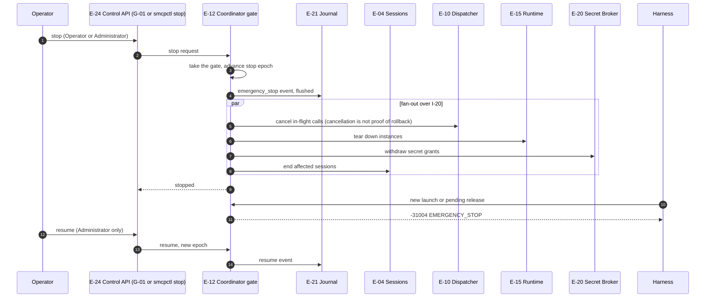

# Emergency stop

How an operator stops all tool execution (FR-4.14, SR-7.6-1, SR-7.6-2, SR-1.16-1; ARCH §18.7). Stop is serialized through the coordinator's gate, so every launch and release is ordered entirely before or after it.

The CP-16 propagation bound and FR-11.10 stop latency apply.

## Implementation

`smcpctl stop --reason <text>`, the console's Stop button and `POST /admin/v1/stop` call `Gateway.Stop` in `internal/edge`, which sets the stop state under the coordinator's gate and commits an `admin` event with outcome `stopped`, the actor and the reason. While stopped, every MCP request (including `initialize`) and every launch and release authorization is refused with `-31004` `EMERGENCY_STOP`, and health is `fail-closed`. The Secret Broker (`internal/secrets`) observes the stop event and withdraws S1 grants and S2 files. `smcpctl resume` (Administrator) commits `resumed` and clears the state. Differences from the diagram:

- In-flight calls are not cancelled; a call that passed release authorization before the stop completes.
- Server instances are not torn down; use `smcpctl runtime kill` or disable the package (see the [runbook](../runbooks/emergency-stop.md)).
- Sessions are not ended.
- There is no Operator role; only the Administrator can stop.
