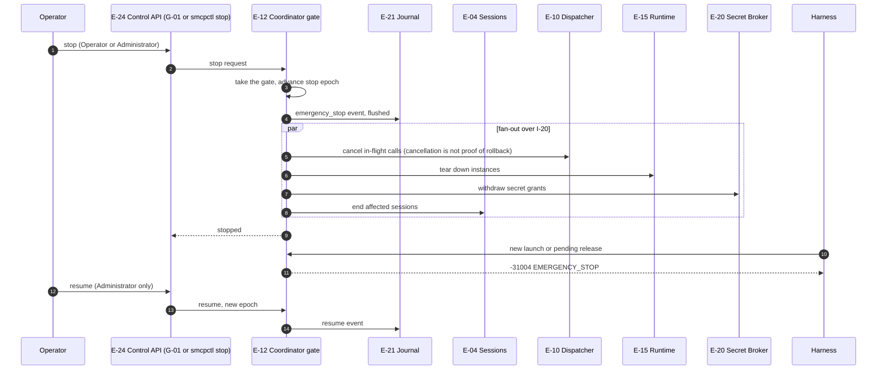

# Emergency stop

How an operator stops all tool execution (FR-4.14, SR-7.6-1, SR-7.6-2, SR-1.16-1; ARCH §18.7). Stop is serialized through the coordinator's gate, so every launch and release is ordered entirely before or after it.

The CP-16 propagation bound and FR-11.10 stop latency apply.

## Implementation as of commit a3193a5

`internal/edge` has `Gateway.Stop` and `Gateway.Resume`, which set a flag checked before the decision, at launch authorization and at release authorization; `/healthz` reports `fail-closed` with cause `emergency_stop`. There is no control API or `smcpctl stop`, so the stop can only be invoked from code and tests. In-flight calls are not cancelled, instances are not torn down and no stop event is journaled.
