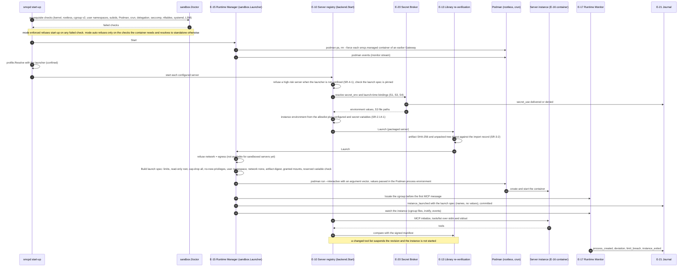

# Enforced sandbox launch

How `smcpd` starts one backend server in a rootless Podman container when `[runtime] sandbox = "podman"` (FR-5.27, FR-13.9, SR-3-2, SR-4-1, SR-4.5-1 to SR-4.7-2, SR-2.14-1; ARCH §18.1). The operator procedure and every option are in the [server sandbox guide](../sandbox.md).

## Implementation

`internal/sandbox` (`FromConfig`, `Launcher`, `Build`, `PodmanArgs`, `Monitor`), wired in `cmd/smcpd/main.go`. The launcher chain from outside in is the library's verifying launcher (`internal/library/runtime.go`), the Secret Broker's wrapper (`internal/secrets/launcher.go`, which withdraws an instance's deliveries when it closes or fails to start) and `sandbox.Launcher`. The Egress Broker hands its attacher to the sandbox launcher (`SetEgress`) instead of wrapping it. Differences from the specification:

- `network = "egress"` is refused for sandboxed servers (`ErrEgressUnsupported`); a sandboxed server has no network at all.
- Instances are shared across sessions; per-session and per-call scopes (FR-5.10), idle teardown (FR-5.11) and restart with crash-loop suspension (FR-5.12) are not implemented. An instance that exits is not restarted.
- When the artifact check in step 14 fails, the revision is suspended and the server is skipped, but the launch-time secret deliveries of step 9 are not withdrawn until the Gateway stops or the alias is launched again, because the verifying launcher sits outside the Secret Broker's wrapper.
- AppArmor and SELinux profiles are passed to Podman only when configured; none ship. The `smcp-srv` service identity is not used.
- `scripts/ci-integration.sh` runs a second instance with `[runtime] sandbox = "podman"` on the linux-integration CI job, where a probe server must fail to open network sockets; the Linux-only tests in `internal/sandbox/integration_linux_test.go` exercise the launcher against Podman. macOS never reaches this flow and always runs the standalone profile.
