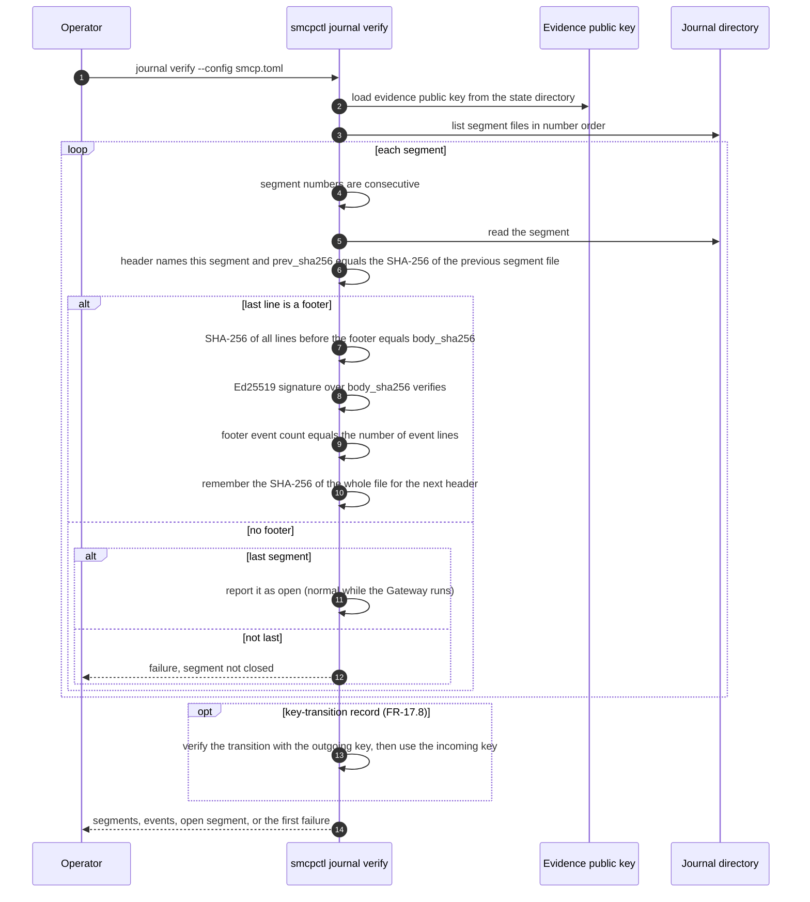

# Evidence journal verification

How `smcpctl journal verify` checks the Evidence Journal (FR-7.4, FR-7.5, FR-17.8, SR-6.12-1). The journal is a directory of JSON Lines segments `segment-NNNNNN.jsonl`; each starts with a header line, holds event lines and, once closed, ends with a footer carrying the SHA-256 of the segment body and an Ed25519 signature over that hash.

## Implementation as of commit a3193a5

`audit.Verify` in `internal/audit/audit.go` performs every step above except key transitions, which do not exist yet. A segment left unclosed by a crash is renamed aside when the journal reopens, so the chain continues from the last closed segment.
