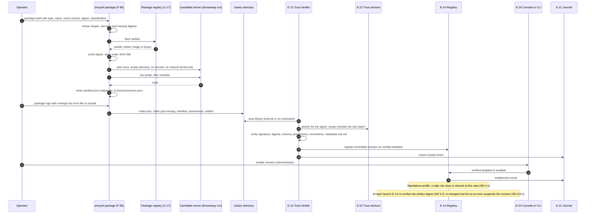

# Server packaging and admission

How an operator admits a local MCP server without an external curation system (FR-14, SR-3-1 to SR-3.10-1, SR-3.5-1, SR-5.9-2; ARCH §18.1). Packaging is the only step that contacts a package registry.

## Implementation as of commit a3193a5

Not implemented. Servers are configured as commands in `smcp.toml`; `internal/backend` starts each one and reads its live tool list at startup. The example written by `smcpctl bootstrap` launches the filesystem server through `npx`, which FR-14.10 and SR-3.6-1 forbid once packaging exists.
