# What you do with Secure MCP Gateway

A guide for someone who has never used the product. It covers the first day, from install to your first approved tool call, and then the tasks you come back for. Each task gives the goal, the commands or clicks, what success looks like and where to go next. Every `smcpctl`, `smcpd` and `install.sh` command here was run on macOS against release v1.1.0 and the main branch, and the screenshots are of a real console. The Claude Code steps follow the [Claude Code quick start](clients/claude-code.md); for this guide the browser sign-in and the tool calls were made by the Gateway's test client with Claude Code's client ID.

## What it is

AI agents such as Claude Code and Codex CLI use MCP servers to get tools: read a file, query a database, open a ticket. Without anything in between, the agent calls the tool directly and nobody checks what it asked for or what came back. Secure MCP Gateway sits between your agents and your MCP servers. Every tool call goes through it. It checks the call against a signed policy before any server code runs, holds calls that a policy marks for approval until a person approves or denies them, inspects what the server returns, and writes each decision to the Evidence Journal: a hash-chained, signed record that shows if anyone changed or removed an entry.

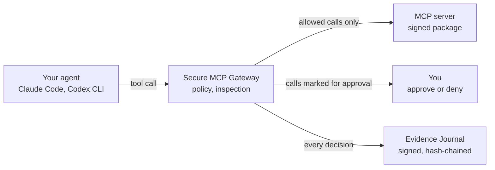

What it does not do: an agent's built-in tools (its own shell, file editor or browser) do not use MCP, so they do not pass through the Gateway. On macOS the Gateway runs in the Standalone profile, labelled `not enforced`; [Standalone and Enforced](#standalone-and-enforced) explains what that means for you.

## Words you will see

| Word | Meaning |
|---|---|
| agent | The AI client that calls tools: Claude Code, Codex CLI, Goose and others. The reference documents call it the harness. |
| MCP server | A program that provides tools. The Gateway starts each one from a signed package. |
| policy | The signed document that says which tools an agent may call and which calls need approval. Each published version is a policy revision (`r1`, `r2`). |
| template | A named set of policy rules. An agent's session uses one template for its whole life. |
| approval | A person's decision on a held tool call: approve or deny. |
| Evidence Journal | The signed record of every decision. "Journal" for short. |
| console | The management web page the Gateway serves at `https://127.0.0.1:8444/`. |
| `smcpctl` | The command-line tool. `smcpd` is the Gateway itself. |

## Day one

You need macOS or Linux, a terminal, and about 20 minutes. The example agent is Claude Code; links to the other agents are in [step 3](#3-connect-your-first-agent).

### 1. Install, with the signature checked

Goal: the six programs on your computer, from a release whose signature you checked.

On macOS, install `minisign` first. The installer needs it to check the release signature, and the `openssl` that ships with macOS cannot do that check.

```sh
brew install minisign
curl -fsSL https://raw.githubusercontent.com/ethan03805/Secure-MCP-Gateway/main/install.sh | sh -s -- --version v1.1.0
```

Success looks like this:

```text
install.sh: downloading smcp_1.1.0_darwin_arm64.tar.gz (v1.1.0)
install.sh: signature verified (smcp_1.1.0_checksums.txt, with minisign)
install.sh: Sigstore bundle verified (cosign, ethan03805/Secure-MCP-Gateway release workflow)
install.sh: checksum verified (b401ce43...)
install.sh: installed smcpd ... smcp-connect to /Users/you/.local/bin
```

The Sigstore line appears only when `cosign` is installed. If any check fails, the script installs nothing. If it says `~/.local/bin` is not on your `PATH`, add it:

```sh
export PATH="$HOME/.local/bin:$PATH"
smcpctl version
```

`smcpctl version` prints `smcpctl 1.1.0`.

Other ways to install (Homebrew, from source, the Linux Enforced host): [install guide](install.md).

### 2. Set up an instance and start it

Goal: a configuration, keys and an example MCP server, and the Gateway running.

```sh
smcpctl bootstrap --dir ~/smcp --notify off
```

`--notify off` turns off desktop notifications for approvals while you try things out; the console shows waiting calls either way. Leave it out to get a notification for each call that waits for you, or change `notify` in the `[approvals]` table of `smcp.toml` later.

It asks for two passwords, each twice, at least 12 characters:

- the Administrator password (account `admin`), for the console;
- the Session Approver password (account `approver`), which you type in the browser when an agent signs in.

`bootstrap` writes `~/smcp/smcp.toml` (the configuration), `~/smcp/policy.json` (the policy), `~/smcp/state/` (keys, the local certificate authority, the journal) and `~/smcp/sandbox/`. It also packages and signs the bundled reference MCP server, `ref`, whose tools read files in `~/smcp/sandbox`: `ref_echo`, `ref_time_now`, `ref_list_files` and `ref_read_file`.

Put a file in the sandbox for the agent to read, then start the Gateway:

```sh
echo "Hello from the sandbox." > ~/smcp/sandbox/notes.txt
smcpd --config ~/smcp/smcp.toml
```

Leave that terminal open. The line `smcpd listening` names the agent address (`mcp=https://127.0.0.1:8443/mcp`), the console address (`admin=https://127.0.0.1:8444`) and `release_label="not enforced"`.

In a second terminal, run every other command of this guide from `~/smcp`. `smcpctl` reads `smcp.toml` from the current directory; from anywhere else, add `--config ~/smcp/smcp.toml`.

```sh
cd ~/smcp
smcpctl health
```

Success: `health: degraded; causes: unconfined; release label: not enforced`. On macOS this is the normal state: `unconfined` means the MCP servers run as ordinary processes, not in a sandbox.

To run the Gateway as a background service that starts at login instead of in a terminal, use `smcpctl install` in place of `bootstrap` and `smcpd`. Its files are under `~/Library/Application Support/smcp-gateway/` on macOS, so you pass `--config` with that path. See [Install as a service](install.md#install-as-a-service-smcpctl-install).

### 3. Connect your first agent

Goal: Claude Code lists the Gateway's tools.

Preview what the setup command will change, then apply it:

```sh
smcpctl clients setup claude-code --dry-run
smcpctl clients setup claude-code --no-lockdown
```

It adds the Gateway as an MCP server named `smcp` to `~/.claude.json` and tells Claude Code to trust the Gateway's certificate authority (`NODE_EXTRA_CA_CERTS` in `~/.claude/settings.json`). `--no-lockdown` skips the system-wide lockdown file, which needs `sudo`; you can add it later ([Claude Code](clients/claude-code.md#lockdown-fr-152)).

Start Claude Code. It finds the Gateway's sign-in page and opens your browser; if it does not, type `/mcp`, select `smcp` and choose to authenticate. The page is the Gateway's own. It names the agent's client ID and principal (`claude-code-local`, set up by `bootstrap`). Sign in as `approver` with the Session Approver password and select **Approve and continue**. The Administrator account is refused on this page.

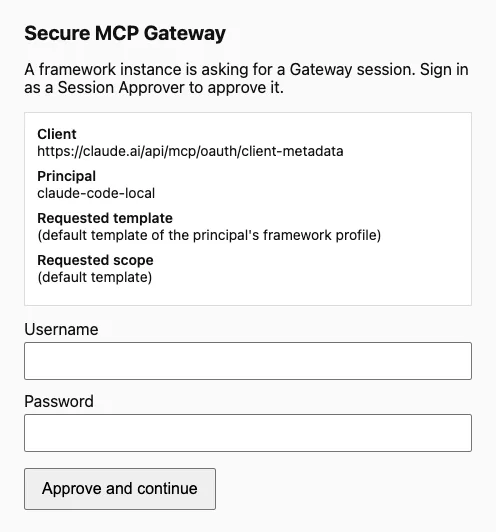

Success: `claude mcp list` shows `smcp` as connected, and in Claude Code the Gateway's tools appear as `mcp__smcp__ref_echo`, `mcp__smcp__ref_list_files` and so on.

`smcpctl clients setup claude-code --remove` puts your Claude Code files back as they were. Other agents: [Codex CLI](clients/codex.md), [Hermes](clients/hermes.md), [OpenCode](clients/opencode.md), [Gemini CLI](clients/gemini-cli.md), [Goose](clients/goose.md), [Grok Build](clients/grok-build.md), and [cloud agents](clients/cloud-agents.md) through the Remote Access Profile. Most of them connect through `smcp-stdio`, which needs a client secret first; the [quick start](quickstart.md#codex-cli-or-any-client-through-smcp-stdio) shows the steps.

### 4. Make a first tool call

Goal: one call that goes through the Gateway and comes back.

Ask Claude Code:

> Use the ref_list_files tool to list the files you can read, then use ref_echo to echo the word hello.

Success: Claude Code calls `mcp__smcp__ref_list_files`, which returns `notes.txt`, and `mcp__smcp__ref_echo`, which returns `hello`.

For each call the Gateway checked the session, decided the call against policy revision `r1` (template `read-only`), ran the request filters, sent the call to the `ref` server, ran the response filters and wrote each step to the journal.

### 5. See it in the console

Goal: the console open and signed in, showing your calls.

Open `https://127.0.0.1:8444/` in your browser. Type the address with `127.0.0.1`, not `localhost`: the console refuses a sign-in from any other host name (`origin_refused`).

The browser warns about the certificate until you trust the Gateway's certificate authority. On macOS:

```sh
security add-trusted-cert -r trustRoot -k ~/Library/Keychains/login.keychain-db ~/smcp/state/tls/ca.crt
```

The authority is limited to loopback names, so trusting it does not let it vouch for other sites.

On the sign-in page keep **Administrator** selected and the username `admin`, enter the Administrator password, and select **Sign in**. The first view is **Gateway control**.

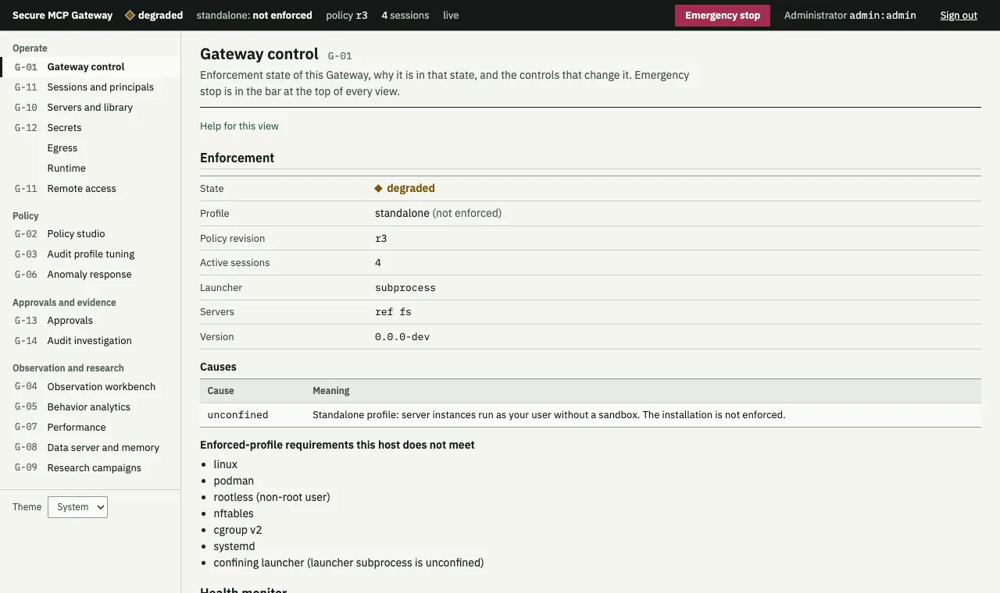

The bar at the top is on every view: the state (`degraded`), `standalone: not enforced`, the active policy revision, the number of sessions, `live` when the console updates by itself, and the **Emergency stop** button. Lower on the same view, the **First-run checklist** marks what you have done so far:

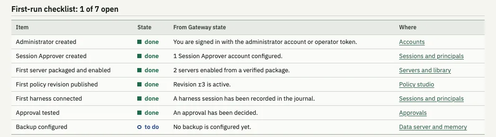

Select **Audit investigation** (G-14) in the left column to see your calls. The next steps use it.

### 6. Handle an approval request

Goal: a call that waits for you, and you approve it.

The example policy has a second template, `approval-demo`, in which `ref_read_file` needs approval. Make it the default. In `~/smcp/policy.json`, change two values:

```json
"revision": "r2",
```

```json
"dev": { "templates": ["read-only", "approval-demo"], "default_template": "approval-demo" }
```

Every published revision needs a new ID; the Gateway refuses a changed document under an ID it already has. Publish the file:

```sh
smcpctl policy reload
```

Success: the output has `"changed": true` and `"revision": "r2"`.

A session keeps the template it started with, so quit Claude Code and start it again. Then ask:

> Read notes.txt with the ref_read_file tool.

Claude Code may ask you to allow the call first, because the Gateway marks tools that need approval. After that, the Gateway holds the call for up to 120 seconds. It appears in the console's **Approvals** view (G-13) within about a second:

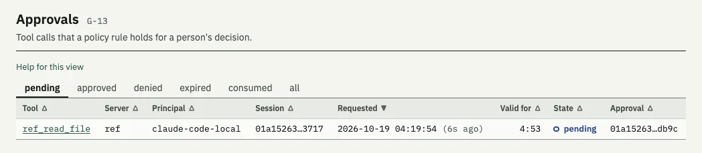

Open it. Check the tool, the server and the arguments; the approval is bound to exactly these. Then select **Approve this call** (or **Deny this call**). You can add a comment, which is recorded with your decision.

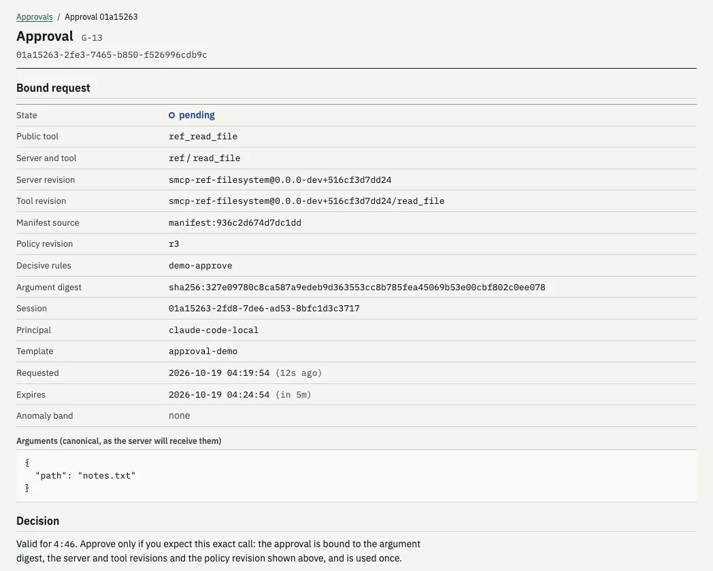

From the terminal instead:

```sh
smcpctl approvals                       # pending approvals, with their IDs
smcpctl approvals show <id>             # what exactly would run
smcpctl approvals approve <id> --comment "checked the path"
smcpctl approvals deny <id> --comment "not this file"
```

`approve` and `deny` ask `[y/N]` before they act; `--yes` skips the question.

Success: Claude Code shows the contents of `notes.txt`, and the approval's state is `consumed` (approved and used). If you decide after the 120 seconds, Claude Code gets an error that says the call needs approval. Approve it, then ask Claude Code to try again: the retry uses your approval, which stays valid for 5 minutes and for that one call only.

More: [tool-call approvals](approvals.md).

### 7. Read the journal

Goal: confirm the journal is intact and find what happened.

```sh
smcpctl journal verify
```

Success: `journal OK: 8 segments, 109 events, anchored at segment 7` (your numbers differ). It checks every signature and the hash chain. If an entry was changed or removed, it says which and exits with status 1.

In the console, **Audit investigation** has **Verify the journal now**, which runs the same check:

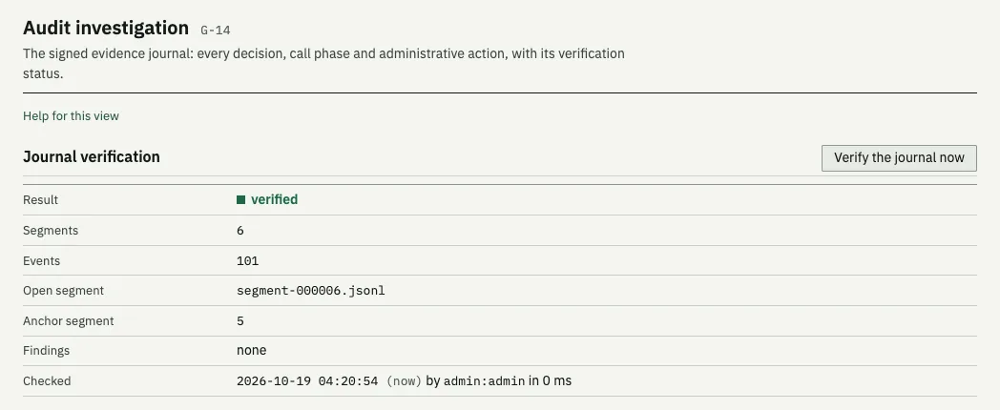

Below it, the events are listed newest first. Type `decision` in **Class** and select **Apply filter** to see only the policy decisions:

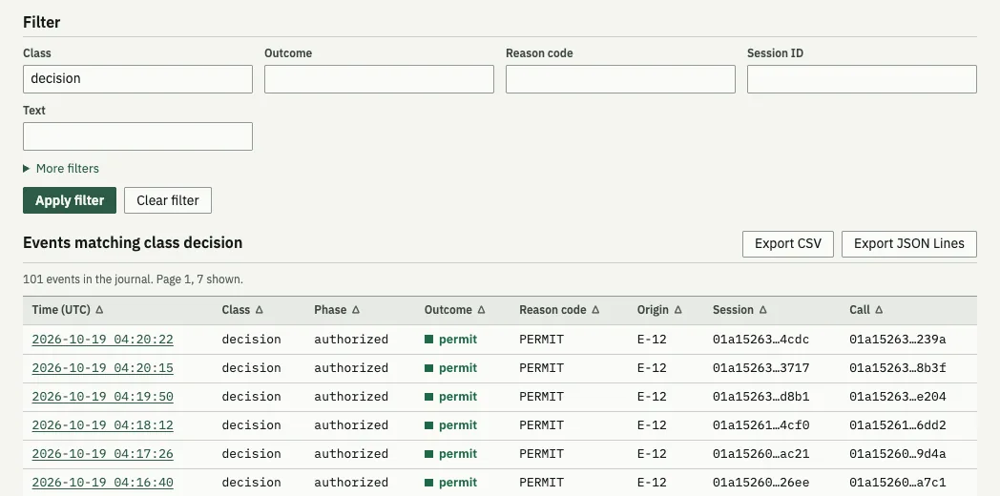

Select an event's time to open it. A decision shows the outcome, the rules that were considered and the one that decided, the policy revision, the session, the principal (which agent), and the server and tool revisions. Its links go to the decision, the call and the session.

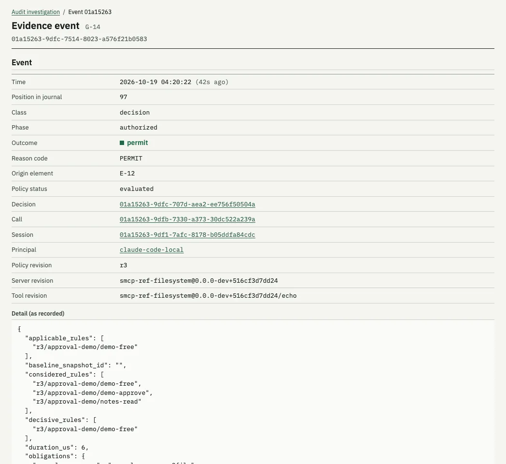

The classes you will see most: `session` (an agent signed in), `decision` (allowed, denied or held), `filter` (a request or response check), `call` (dispatched, completed, delivered), `approval`, `auth_failure` (a refused sign-in or token), `admin` (something an operator did, such as publishing a policy) and `health` (a change of state).

That is day one. The Gateway is running, an agent is connected, and you have approved a call and checked the record.

## Everyday tasks

The commands below assume you are in `~/smcp`, as on day one.

### Add an MCP server package

Goal: give your agent the tools of another MCP server. The example adds the official filesystem server, limited to one folder, `~/notes`.

The Gateway runs only servers that are packaged and signed, by you, with a key it trusts. Package runners such as `npx` and `uvx` are refused. You need Node.js and npm for this server, a network connection, and the recipe, which is in the repository under `packaging/reference/filesystem/`:

```sh
git clone https://github.com/ethan03805/Secure-MCP-Gateway.git ~/src/smcp
mkdir -p ~/notes ~/keys
```

1. Make a signing key, once. Without `--unencrypted` it asks for a passphrase to protect the key.

   ```sh
   smcpctl package keygen --out ~/keys/smcp-packages
   ```

   It prints the key ID, for example `key 9498671CFEF09454`.

2. Tell the Gateway to trust packages signed with that key. Use the key ID it printed.

   ```sh
   smcpctl trust add ~/keys/smcp-packages.pub --name operator --key-id 9498671CFEF09454 --expires 365d
   ```

   Success: `enrolled operator (key 9498671CFEF09454) for risk classes low,moderate until ...`.

3. Build the package. This downloads the pinned server, checks its digest, starts it once and records its tools.

   ```sh
   smcpctl package build --recipe ~/src/smcp/packaging/reference/filesystem/recipe.json --out pkg-fs
   ```

   Success: `built mcp-filesystem@2026.8.31 in pkg-fs` and a list of 14 tools. Look at `pkg-fs/manifest.json` before you sign: it is what you are vouching for.

4. Sign it, check it, and put it in the library.

   ```sh
   smcpctl package sign pkg-fs --key ~/keys/smcp-packages.key
   smcpctl package verify pkg-fs
   smcpctl package install pkg-fs --enable --alias fs
   ```

5. Add the server to `smcp.toml`, after the existing `[[server]]` entry. The `root` slot is the only folder this server may use. Use the full path; `~` is not expanded here.

   ```toml
   [[server]]
   alias = "fs"
   package = "mcp-filesystem"
   slots = { root = "/Users/you/notes" }
   ```

   Then stop `smcpd` (Ctrl-C in its terminal) and start it again. A new server needs a restart; `smcpctl reload` says so (`restart_required`).

6. Let the agent use two of its tools. In `policy.json`, add a rule to the template your agent uses (`approval-demo` after day one), and give the document a new revision ID:

   ```json
   { "id": "notes-read", "server": "fs", "tools": ["list_directory", "read_text_file"] }
   ```

   ```sh
   smcpctl policy reload
   ```

Success: `smcpctl servers list` shows `fs` with `"state": "running"` and `"verified": true`, and the console's **Servers and library** view (G-10) lists it. After you restart Claude Code, it has `mcp__smcp__fs_list_directory` and `mcp__smcp__fs_read_text_file`. The other 12 tools of the server, such as `write_file`, are not offered because no rule grants them.

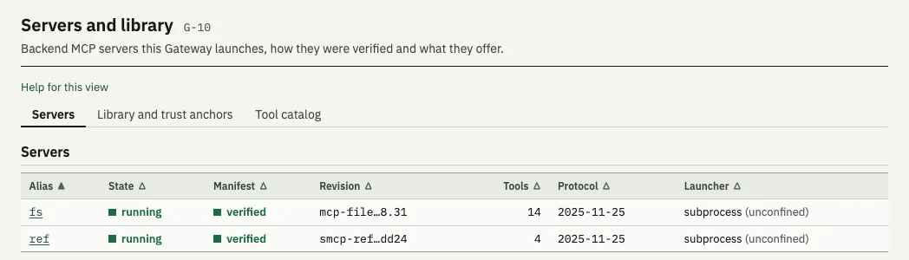

Next: [packaging guide](packaging-guide.md) for your own servers, recipes, risk classes and revoking a package.

### Change a policy

Goal: change what an agent may do, see the effect before it is live, and undo it if needed.

The policy in force is a signed revision stored by the Gateway, not the file. Editing `policy.json` changes nothing until you publish. Edit the file, give it a new `revision` ID, then:

```sh
smcpctl policy validate policy.json     # checks the document, offline
smcpctl policy diff policy.json         # what changes against the active revision
smcpctl policy simulate policy.json     # replays recent calls from the journal against it
```

`diff` prints each change, for example `profile_changed  dev  ... default=read-only -> ... default=approval-demo`. `simulate` prints how many recent calls would get a different result and a simulation ID. Publish with that ID, so the record shows you checked:

```sh
smcpctl policy publish policy.json --parent r1 --simulation <simulation id>
smcpctl policy history
```

`--parent` is the active revision you started from; `history` marks it with `*`. Success: `published and activated revision r2`. `smcpctl policy reload` does validate and publish in one step, without the diff and simulation.

To undo, publish an earlier revision's content again:

```sh
smcpctl policy rollback r1
```

It is published as a new revision (`r1-rb1`), so the history keeps every step. Your `policy.json` no longer matches what is active; give your next edit a new revision ID.

A session keeps the template it started with, but each call is decided against the active revision, so a rule you remove from that template applies to open sessions at once. A change of `default_template` affects new sessions only. The console's **Policy studio** (G-02) has the same steps: a draft editor, **Validate**, **Diff against the active revision**, **Simulate**, **Publish** and **Roll back**.

Next: [policy reference](policy-reference.md) for rules, deny rules, rates, quotas and approval obligations; [policy rollback runbook](runbooks/policy-rollback.md).

### Review what an agent did

Goal: find every call one agent made, and why each was allowed or not.

1. In the console, open **Sessions and principals** (G-11). Each session shows its principal (which agent), its template and when it started. Copy the session ID.
2. Open **Audit investigation**, paste the ID into **Session ID**, and select **Apply filter**. The filter is part of the page address, so you can bookmark it.
3. Open a `decision` event to see which rule decided. Open a `filter` event to see what a request or response check found.
4. To keep a copy, select **Export CSV** or **Export JSON Lines**. The export contains the events that match the filter, and is itself recorded in the journal.

When an agent reports an error from the Gateway, the error has a `correlationId`. Put it in **Correlation ID** under **More filters** to find that call.

To end a session now, open it in **Sessions and principals** and select **Terminate session**. Its token is refused at once; the agent has to sign in again.

Next: [management console](console.md#journal-browser-and-export), [troubleshooting](troubleshooting.md) for every error and reason code.

### Respond to a health warning

Goal: find out why the Gateway is not `healthy` and fix it.

```sh
smcpctl health
```

The first line is the state and the active causes. There are three states:

| State | What happens to tool calls |
|---|---|
| `healthy` | Nothing is wrong. |
| `degraded` | Calls go through. Something needs your attention. |
| `fail-closed` | Every call is refused until the cause is fixed. |

The console's **Gateway control** view lists the same causes in **Health monitor**. Here a server stopped answering:

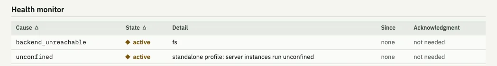

What to do about the causes you are most likely to see:

| Cause | What to do |
|---|---|
| `unconfined` | Nothing. It is always there in the Standalone profile. |
| `backend_unreachable` | The server named in the detail did not answer a check within 2 seconds. Look at `smcpctl servers list` and the end of `~/smcp/state/log/smcpd.log`, then restart `smcpd`. The cause clears by itself when the server answers. |
| `keys_expiring` | The certificate authority or the listener certificate expires within 30 days: `smcpctl keys rotate tls`, or `smcpctl keys rotate ca`. |
| `disk_space_low`, `storage_quota_journal` | Less than 1 GiB free, or the journal is at 80% of its quota. Free space, or copy old journal segments off the machine with `smcpctl journal export --to <dir>`. |
| any cause with `fail-closed` | Fix the cause. The Gateway waits until it has been clear for 10 seconds. Some causes (`evidence_unavailable`, `trust_anchor_invalid`) also need you to confirm: `smcpctl health ack <cause>`, or **Acknowledge** in the console. |

An emergency stop also shows `fail-closed`; see the next task.

Next: [every health cause](operations/health.md), [troubleshooting](troubleshooting.md).

### Stop everything

Goal: no tool call runs, now.

```sh
smcpctl stop --reason "fs server is reading files it should not"
```

Success: `"state": "stopped"`. In the console, select **Emergency stop** in the top bar, enter a reason, and select **Stop the Gateway**. The bar turns red and shows `emergency stop`:

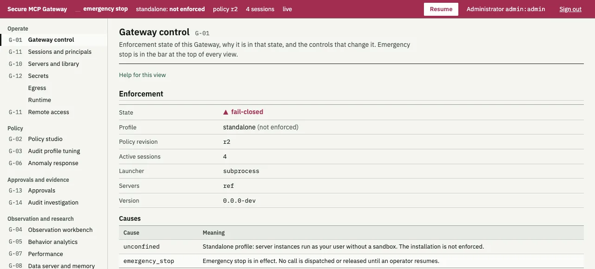

While stopped, every request from every agent is refused with the message "The Gateway operator has stopped all tool calls." (reason code `EMERGENCY_STOP`). The stop and your reason are recorded in the journal. A call already sent to a server before the stop may still finish; the [emergency stop runbook](runbooks/emergency-stop.md) says how to end server processes and sessions as well.

When the cause is fixed:

```sh
smcpctl resume
```

Success: `"state": "running"`. Only the Administrator can resume. Make one known-good call to confirm agents work again.

If the Gateway does not answer at all, stop the `smcpd` process (Ctrl-C in its terminal, or `kill <pid>`). That ends every server it started.

### Back up and restore

Goal: a copy you can restore after a lost disk, a bad change or a move to a new computer.

Put a passphrase in a file only you can read, and keep a copy of it somewhere other than this computer:

```sh
umask 077
echo "a long passphrase only you know" > ~/smcp-backup.pass
smcpctl backup --passphrase-file ~/smcp-backup.pass
smcpctl backup --list
```

Success: `backup written: /Users/you/smcp/backups/smcp-backup-<time>.age`, its `sha256`, and the parts it holds: `configuration, evidence_journal, key_material, policy_store, server_registry, trust_anchors`. In `--list`, the newest entry has `"result": "ok"`. The Gateway can keep running; it pauses calls for a moment to take a consistent copy.

The archive contains your private keys, encrypted with the passphrase. Copy the `.age` file off the computer and keep it away from the passphrase.

To restore, check the archive first, then stop the Gateway and restore:

```sh
smcpctl restore --archive backups/smcp-backup-<time>.age --passphrase-file ~/smcp-backup.pass --verify-only
# stop smcpd (Ctrl-C), then:
smcpctl restore --archive backups/smcp-backup-<time>.age --passphrase-file ~/smcp-backup.pass
smcpctl journal verify
```

`--verify-only` ends with `archive verified; nothing was changed`. The restore refuses to run while `smcpd` runs. Success: `restored; the previous state is kept at .../state.pre-restore-<time>`, then `journal OK`. Start `smcpd` again. Keep the `state.pre-restore-...` folder: its journal holds what happened after the backup.

Next: [backup and restore runbook](runbooks/backup-restore.md), [backups in detail](operations/backup.md).

### Upgrade

Goal: a new release, with the signature checked, a backup taken first, and an automatic return to the old version if the new one does not start.

Download the new release's checksum file, its signature and the archive for your computer into one folder. With the GitHub CLI, on a Mac with Apple silicon:

```sh
gh release download v<version> -R ethan03805/Secure-MCP-Gateway -D ~/Downloads/smcp-<version> \
  -p 'smcp_<version>_checksums.txt*' -p 'smcp_<version>_darwin_arm64.tar.gz'
```

If you installed with `smcpctl install` (a launchd or systemd service):

```sh
smcpctl upgrade --release ~/Downloads/smcp-<version> --passphrase-file ~/smcp-backup.pass
```

If you start `smcpd` yourself in a terminal, tell the upgrade how to stop and start it:

```sh
smcpctl upgrade --release ~/Downloads/smcp-<version> --passphrase-file ~/smcp-backup.pass \
  --stop-cmd 'pkill -x smcpd' \
  --start-cmd 'nohup smcpd --config ~/smcp/smcp.toml >> ~/smcp/smcpd.out 2>&1 &'
```

Success, from an upgrade of 1.0.0 to 1.1.0:

```text
upgrade: release verified: signature of smcp_1.1.0_checksums.txt and checksum of smcp_1.1.0_darwin_arm64.tar.gz
upgrade: upgrading from 1.0.0 to 1.1.0
upgrade: backup written: .../backups/smcp-backup-<time>.age
upgrade: dispatch stopped
upgrade: installed smcpd, smcpctl, smcp-refserver, smcp-connect, smcp-stdio, smcp-session
upgrade: Gateway answers: state degraded, version 1.1.0
upgrade: upgrade complete; the previous binaries are kept as <name>.prev in /Users/you/.local/bin
```

`smcpctl version` then shows the new version for both `smcpctl` and `smcpd`. If the new version does not become healthy within 60 seconds, the upgrade restores the backup and the old programs and ends with `upgrade rolled back: <reason>; the previous version is running`.

With Homebrew, run `smcpctl backup` first, then `brew upgrade smcp`, then restart the Gateway. That path has no automatic rollback.

Next: [upgrade rollback runbook](runbooks/upgrade-rollback.md), [install guide](install.md#upgrade-and-rollback).

## Standalone and Enforced

The Gateway has two profiles. It picks one when it starts, and shows it everywhere it shows its state.

| | Standalone | Enforced |
|---|---|---|
| Where | macOS, and Linux without the prerequisites | Linux with rootless Podman, nftables, cgroup v2, systemd and AppArmor or SELinux, installed as root |
| Label | `not enforced`, always | `enforced` for a release whose acceptance tests passed on that profile |
| Policy, approvals, inspection, journal | Yes | Yes |
| MCP servers run | As ordinary processes, under your user | Each in its own rootless container: no capabilities, read-only root, resource limits |
| Server network access | Whatever your user has | None, except through the Egress Broker's per-server grants |
| High-risk servers | Refused | Allowed, inside the sandbox |
| Health | At best `degraded: unconfined` | Can be `healthy` |

What Standalone means for you, in practice:

- The Gateway decides which tool calls run, holds the ones that need approval and records everything. That part is the same in both profiles.
- Once a server runs, nothing but your user's own permissions limits it. A server you admitted can read any file you can read and open any network connection you can. The policy controls which tools the agent may call and with what arguments; it does not contain the server's code. Admit only servers you trust, and give each one the narrowest `root` folder.
- Your agent also runs as you, so it can read the Gateway's files, including `~/smcp/state`. `smcpctl doctor` reports this as `readable-path` findings, which cannot be fixed in this profile. The lockdown (`smcpctl lockdown apply claude-code`, with `sudo`) stops Claude Code from using other MCP servers and from reading or editing the Gateway's files with its own tools, but it is a setting in the agent, not an operating-system boundary.
- The agent's built-in shell, file and browser tools never pass through the Gateway, in either profile.

Use Standalone to control and record what your agents do through MCP on your own computer. Use Enforced on a Linux host when the MCP servers themselves must not be trusted.

Next: [security limitations](security-limitations.md) for the full list, [Enforced profile on Linux](enforced-profile.md) to set one up, [client setup and lockdown](harness.md).

## Coming in v1.3 (planned)

These are planned for release v1.3.0. They are specified but not built, and none of them is in v1.1.0.

- **Desktop application.** A tray (menu-bar) icon on macOS, Linux and Windows that shows the Gateway's state, the number of calls waiting for approval, Start, Stop and Restart, a console window and **Set Up a Client**, so you do not need a terminal for daily use ([FR-20](https://secure-mcp-gateway-pearl.vercel.app/requirements/#FR-20)).
- **Installers.** A macOS `.pkg` and `.dmg`, Linux `.deb`, `.rpm` and AppImage packages, and a Windows `.msi`, each checked with the same minisign signature, Sigstore bundle and checksums as today's archives.
- **Windows.** The Gateway as a Windows service on Windows 10 22H2 and later and Windows 11 (x86_64), controlled by the desktop application. The Windows requirements are still being written.
- **ContextForge.** Import servers from the IBM ContextForge catalog into your library, under the same packaging, signature and policy checks as any other package, and reach hosted MCP servers through a bundled ContextForge instance that only the Gateway can talk to ([FR-22](https://secure-mcp-gateway-pearl.vercel.app/requirements/#FR-22)).

## Where to go next

- [Quick start](quickstart.md): the day-one steps in short form, with Codex CLI through `smcp-stdio`.
- [Operator guide](operator-guide.md): accounts and roles, secrets, keys, remote access and every other operator task.
- [Runbooks](README.md#runbooks-fr-188): step-by-step procedures for emergencies.
- [Troubleshooting](troubleshooting.md): every error and reason code with the next action.
